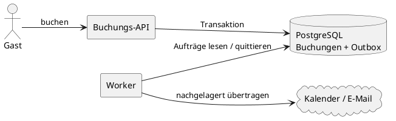
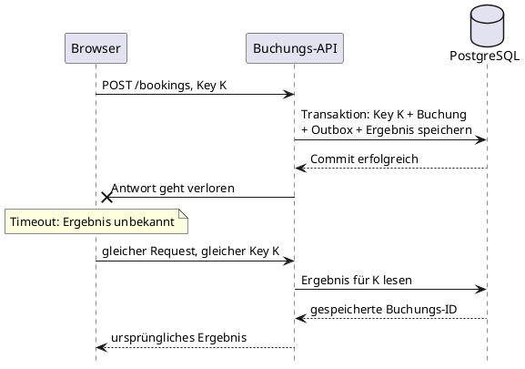

---
title: "Skalierbare Systeme - Resilienz, Fehlertoleranz & Hochverfügbarkeit"
topic: "scalable_systems_1_4"
author: "Lukas Panni"
theme: "metropolis"
fonttheme: "structurebold"
fontsize: 12pt
urlcolor: BrickRed
linkcolor: BrickRed
aspectratio: 169
lang: de-DE
numbersections: true
plantuml-format: svg
toc: true
section-titles: true
...

<!--
Time plan: 4 VE = 180 min content, Friday 8:30-11:45 with a 15 min break on top.
  Heute, Lernziele                         5
  Grundlagen                              35   includes Cal.diy teaching model and worked booking SLI/SLO
  Redundanz und Hochverfügbarkeit         25   includes capacity reserve and split brain
  Resilienz-Muster                        60   includes retry sequence and failure cascades
  Resilienz testen                        35   2 slides + post-mortem case ~10 + example ~12
  AI Engineering                          15
  Zusammenfassung                          5
  Sum                                    180   no slack; estimates, not rehearsed
The requested reduction to 150 min and new student work phases are deferred.
-->

# Grundlagen

## Heute

- Begriffe: Fehler, Ausfall, Verfügbarkeit, Resilienz
- Warum verteilte Systeme scheitern
- Redundanz und Hochverfügbarkeit
- Resilienz-Muster
- Resilienz testen
- AI Engineering: Resilienz für KI-Komponenten
- Durchgängiges Beispiel: Cal.diy-Terminplattform aus Vorlesung 2

## Lernziele

- Verfügbarkeit definieren, messen und über Fehlerbudgets steuern
- Typische Ausfallarten verteilter Systeme erkennen
- Redundanz- und Failover-Strategien für zustandslose und zustandsbehaftete Komponenten entwerfen
- Resilienz-Muster gezielt einsetzen und ihre Nebenwirkungen kennen

## Unser Beispiel: Cal.diy unter Störungen

- Terminplattform aus Vorlesung 2: freie Zeiten anzeigen, buchen, Kalender aktualisieren
- Wir erweitern das **Teaching-Model**, nicht die behauptete Ist-Architektur von Cal.diy
- Buchungen und Mandantendaten liegen in PostgreSQL
- Ein Worker überträgt gespeicherte Aufträge an Kalender- und E-Mail-Dienste
- Was passiert bei verlorenen Antworten, langsamen Abhängigkeiten oder einem Datenbankausfall?

## Cal.diy: unser Lehrmodell

- Buchung und Outbox-Eintrag werden gemeinsam gespeichert (Bezug Vorlesung 2)
- Buchungserfolg und externe Synchronisation sind getrennte Zustände
- Annahme: Die Plattform verwaltet die buchbaren Slots verbindlich; externe Kalender werden nachgelagert synchronisiert

## Begriffe

- Fault, Error, Failure: Ursache, Zustand, Wirkung
- Zuverlässigkeit: funktioniert korrekt, auch wenn etwas schiefgeht
- Verfügbarkeit: ist erreichbar, wenn gebraucht
- Resilienz: erholt sich von Störungen
- Robustheit: hält Störungen aus, ohne sich zu verändern

## Verfügbarkeit messen

- Die Neunen: 99 %, 99,9 %, 99,99 % und was sie im Jahr bedeuten
- MTBF und MTTR: Ausfälle vermeiden vs. schnell beheben
- SLI, SLO, SLA: messen, zielen, versprechen
- Fehlerbudget: Wie viel Ausfall dürfen wir uns leisten?
- Verfügbarkeit verketteter Komponenten: Multiplikation der Wahrscheinlichkeiten

## Unser Buchungs-SLI: Was zählt als Erfolg?

- **Grundgesamtheit:** eindeutige, gültige Buchungsabsichten für einen zuvor als frei angezeigten Slot; pro Idempotency Key nur einmal zählen
- Ausgeschlossen: ungültige Eingaben, fehlende Berechtigung, Health Checks und technische Retries derselben Absicht
- **Gutes Ereignis:** Buchung dauerhaft gespeichert und Bestätigung innerhalb von 2 Sekunden zurückgegeben
- Fehler, Timeout, verspätete Antwort oder fehlende Bestätigung zählen als schlecht – auch wenn ein Retry später gelingt
- **Messfenster:** rollierende 28 Tage; ein zeitbasiertes Uptime-SLI wäre eine andere Messgröße
- **SLO:** mindestens 99,9 % gute Buchungsabsichten pro Messfenster

## Fehlerbudget einmal berechnet

- Im 28-Tage-Fenster: 50.000 eindeutige Buchungsabsichten, davon 49.960 gut und 40 schlecht
- SLI: $49.960 / 50.000 = 99{,}92\%$; SLO: $99{,}9\%$
- Fehlerbudget: höchstens $0{,}1\% \times 50.000 = 50$ schlechte Absichten
- Verbraucht: 40 von 50, also 80 %; verbleibend: 10 schlechte Absichten
- Das Budget zählt Nutzerereignisse, nicht Minuten; schneller Erfolg nach einem Fehler-Retry zählt nicht rückwirkend als gut

## Warum verteilte Systeme scheitern

- Das Netzwerk ist unzuverlässig: Partitionen, Latenz, Paketverlust
- Uhren gehen falsch, Zeit ist nicht global
- Teilausfälle: Ein Knoten weiß nicht, ob der andere tot oder nur langsam ist
- Fallacies of Distributed Computing (Peter Deutsch)

## Ausfallarten

- Crash, Omission, Timing, Byzantine
- Korrelierte Ausfälle: gleiche Zone, gleiches Deployment, gleicher Bug
- Kaskadierende Ausfälle: Ein Fehler zieht den nächsten nach
- Metastabile Ausfälle: Das System erholt sich nicht von selbst

# Redundanz und Hochverfügbarkeit

## Redundanz auf allen Ebenen

- Instanzen, Verfügbarkeitszonen, Regionen
- Active-Active vs. Active-Passive
- Redundanz kostet: Geld, Komplexität, Konsistenzprobleme
- Wo ist der Single Point of Failure, den wir übersehen haben?

## Cal.diy: Redundanz ohne Reserve?

- Zwei gleich große API-Instanzen bedienen die Buchungen
- Beide laufen mit jeweils 60 % ihrer Verarbeitungskapazität
- Eine fällt aus: Die andere müsste bei gleicher Last rechnerisch 120 % übernehmen
- Wartezeiten und Timeouts steigen; Retries können die Überlast verstärken
- Reserve für den Ausfallfall vorhalten und überschüssige Last gezielt ablehnen
- Autoscaling hilft nicht sofort: neue Instanzen müssen erst starten und warm werden

## Failover und Konsens

- Ausfall erkennen: Heartbeats, Timeouts, die Grauzone
- Leader Election, Split Brain, Quorum
- Konsensprotokolle in einem Satz: Raft, Paxos
- Wer benutzt das: etcd, ZooKeeper, Kubernetes, Datenbank-Cluster

## Cal.diy: Failover kann Doppelbuchungen ermöglichen

- Der Datenbank-Leader ist vom Cluster getrennt, aber für einige API-Instanzen noch erreichbar
- Die Mehrheitsseite wählt einen neuen Leader; der alte hält sich weiterhin für zuständig
- **Ohne Schreibschutz für den alten Leader:** Beide Seiten könnten denselben Slot bestätigen
- Ein Unique Constraint schützt nur innerhalb der jeweiligen Datenbankhistorie
- Ein Timeout beweist nicht, dass der alte Leader aufgehört hat zu schreiben
- **Fencing:** Den alten Leader zuverlässig vom Schreiben ausschließen, z.B. durch Abschalten oder Entzug des Storage-Zugriffs
- Sichere Schreibberechtigung ist Voraussetzung für Failover; eine unklare Seite muss Schreibzugriffe ablehnen

## Zustandslos vs. zustandsbehaftet

- Zustandslose Services: replizieren und Load Balancer davor
- Datenbanken: Replikation, automatisches Failover, Backups (Bezug Vorlesung 2)
- RPO und RTO: Wie viel Datenverlust und wie lange Ausfall sind akzeptabel?
- Zustand in Queues und Caches nicht vergessen

## Disaster Recovery

- Backup-Strategien: 3-2-1, Restore regelmäßig testen
- Multi-Region: Active-Active, Warm Standby, Pilot Light, Backup-and-Restore
- Kosten gegen Nutzen: Was kostet eine Stunde Ausfall?
- Runbooks für den Ernstfall

# Resilienz-Muster

## Timeout: Ist die Buchung fehlgeschlagen?

- Der Gast sendet eine Buchung an die Cal.diy-API
- Die Datenbank bestätigt den Commit, aber die Antwort erreicht den Gast nicht
- Nach Ablauf des Timeouts zeigt der Browser einen unklaren Status
- **Timeout bedeutet: Ergebnis unbekannt, nicht: Operation nicht ausgeführt**
- Ein erneuter Request kann die fachliche Aktion nochmals auslösen

## Cal.diy: verlorene Antwort und sicherer Retry

## Timeouts: ein Zeitbudget für den gesamten Request

- Netzwerkaufrufe begrenzen: Verbindungsaufbau und Antwortzeit berücksichtigen
- Beispiel: Für die interaktive Buchung stehen insgesamt 2 Sekunden zur Verfügung
- Aufrufe und Wiederholungen teilen dieses Budget; nicht jeder Versuch bekommt neue 2 Sekunden
- Verbleibende Deadline an nachgelagerte Dienste weitergeben
- Zu kurze Timeouts erzeugen unnötige Wiederholungen, zu lange binden Ressourcen
- Ein Abbruch macht bereits gespeicherte Buchungen nicht rückgängig

## Retries: wann und wie oft?

- Nur geeignete, vorübergehende Fehler wiederholen, z.B. Verbindungsfehler oder HTTP 503
- Ungültige Eingaben oder einen belegten Slot nicht unverändert erneut senden
- Bei HTTP 429: `Retry-After` berücksichtigen, sofern vorhanden
- **Exponential Backoff:** Wartezeit zwischen Versuchen vergrößern, mit Obergrenze
- **Jitter:** Wartezeiten zufällig streuen, damit nicht alle Clients gleichzeitig wiederholen
- Versuchszahl und Gesamtdeadline begrenzen; ohne Restbudget abbrechen
- Schreiboperationen nur wiederholen, wenn ihre Wirkung gegen Duplikate abgesichert ist

## Idempotenz: dieselbe Absicht, keine zusätzliche Wirkung

- Idempotent: Mehrfaches Ausführen hat dieselbe beabsichtigte Wirkung wie einmaliges Ausführen
- „Buchung auf storniert setzen“ kann natürlich idempotent sein; „neue Buchung anlegen“ ist es nicht
- Der Client erzeugt einen **Idempotency Key pro Buchungsabsicht** und behält ihn bei Retries bei
- Die API ordnet dem Schlüssel das ursprüngliche Ergebnis zu und liefert es erneut
- Eine neue Buchungsabsicht erhält einen neuen Schlüssel
- Der Unique Constraint für einen Slot bleibt nötig: Zwei unterschiedliche Buchungsabsichten dürfen ihn nicht doppelt belegen (Bezug Vorlesung 2)

## Idempotency Keys: der Header allein reicht nicht

- Schlüssel an Mandant und Operation binden; Berechtigungen bei jedem Request prüfen
- Request-Inhalt vergleichen: gleicher Schlüssel mit anderem Inhalt wird abgelehnt
- Schlüssel, Buchung, Outbox-Eintrag und Ergebnis in einer Datenbanktransaktion speichern
- Eindeutiger Schlüssel und Transaktionslogik koordinieren gleichzeitige Wiederholungen
- Solange der erste Request läuft: begrenzt warten oder „noch in Bearbeitung“ zurückgeben, nicht erneut ausführen
- Aufbewahrungsdauer festlegen: Nach Ablauf des Schlüssels ist ein alter Retry nicht mehr zuverlässig deduplizierbar

## Cal.diy: Wenn Retries den Kalenderausfall verstärken

- Der Kalenderdienst wird langsam; der Worker wiederholt die Übertragung
- Worker, HTTP-Client und Proxy versuchen jeweils bis zu dreimal, inklusive Erstversuch
- Im schlechtesten Fall: $3^3 = 27$ Kalenderaufrufe für einen einzigen Auftrag
- Zusätzliche Last verzögert Antworten weiter und löst noch mehr Timeouts aus
- Retries an einer verantwortlichen Stelle bündeln; **Retry-Budget** für zusätzliche Versuche begrenzen
- Kalenderaufrufe separat begrenzen, Backoff mit Jitter nutzen und Aufträge erst später erneut versuchen

## Circuit Breaker: Fehlerkaskaden unterbrechen

- **Closed:** Aufrufe passieren; Fehlerquote oder Timeout-Schwellwert über ein Zeitfenster öffnet den Breaker
- **Open:** Aufrufe werden sofort abgewiesen oder auf einen Fallback gelenkt; keine wartenden Threads für eine kaputte Abhängigkeit
- Nach einer Abkühlzeit **half-open:** nur wenige Probeaufrufe zulassen
- Probe erfolgreich: zurück zu closed; Probe scheitert: zurück zu open und erneut warten
- **Cal.diy:** Kalenderaufrufe nach erschöpftem Retry-Budget pausieren; Buchung bleibt gespeichert, Synchronisation ausstehend
- Breaker ersetzt weder Timeout noch Retry-Limit; sonst kann ein langsamer Aufruf den Zustand nie rechtzeitig melden

## Bulkhead: Ressourcen voneinander isolieren

- Begrenzte, getrennte Pools oder Limits halten Fehler und Rückstau innerhalb einer Abhängigkeit
- **Cal.diy:** eigener Worker-Pool für Kalenderaufrufe, damit ein langsamer Kalender keine E-Mails blockiert
- Zusammen mit Queue und Lastgrenze verhindert Isolation nicht den Ausfall, aber dessen Ausbreitung

## Last begrenzen

- Rate Limiting: Token Bucket, Leaky Bucket; pro Client, pro Mandant
- Load Shedding: lieber einige ablehnen als alle verlieren
- Backpressure: Druck zurück zum Erzeuger statt Puffer bis zum Absturz
- Cal.diy: Limits pro Mandant; interaktive Buchungen vor großen Kalender-Nachsynchronisationen priorisieren

## Graceful Degradation

- Fallbacks: Cache, Default, reduzierte Funktion
- Feature Flags und Kill Switches
- Kernfunktion schützen, Komfortfunktion opfern
- Cal.diy-Lehrmodell: Buchung speichern, Kalender-Synchronisation als „ausstehend“ anzeigen
- Voraussetzung: Buchbare Slots werden verbindlich intern verwaltet; ohne verlässliche Verfügbarkeit keine Buchung bestätigen

## Health Checks und Selbstheilung

- Liveness vs. Readiness
- Orchestrierung: Neustart, Ersatz, Verschieben (Vertiefung in Vorlesung 6)
- Gefahr: Health Checks, die selbst Last erzeugen oder kaskadieren
- Startup-Verhalten: langsam anfahren, Warm-up

## Cal.diy: Health Check als Ausfallverstärker

- Die Datenbank ist kurz nicht erreichbar, die API-Prozesse selbst funktionieren
- Prüft Liveness die Datenbank, werden alle API-Instanzen als defekt neu gestartet
- Neue Verbindungen und Warm-up erzeugen Zusatzlast; der Datenbankfehler bleibt bestehen
- **Liveness:** Ist der Prozess so defekt, dass ein Neustart helfen kann?
- **Readiness:** Kann die Instanz den vorgesehenen Traffic bedienen? Nicht bereite Instanzen erhalten keinen regulären Traffic
- Abhängigkeiten nicht pauschal prüfen: Ein ausgefallener Kalender darf die Buchungs-API unseres Lehrmodells nicht stilllegen

## Entkopplung über Queues

- Queue als Puffer zwischen Produzent und Konsument
- Dead Letter Queues für Nachrichten, die nicht verarbeitbar sind
- Outbox-Pattern: Datenbankänderung und Nachricht atomar
- Nebenwirkungen: Latenz, Reihenfolge, Duplikate

## Cal.diy: Rückstand nach dem Kalenderausfall

- Während des Ausfalls sammeln sich Synchronisationsaufträge in der Outbox
- Eine Queue puffert Last, erhöht aber nicht die Verarbeitungskapazität des Kalenders
- Nach Wiederkehr nicht alles gleichzeitig senden: Parallelität begrenzen und langsam hochfahren
- Eingangsrate dauerhaft größer als Verarbeitungsrate: Rückstand und Wartezeit wachsen weiter
- Nachrichtenalter und Rückstand überwachen; Grenzen und Umgang mit veralteten Aufträgen festlegen
- At-least-once: Absturz nach Versand, aber vor Quittierung kann Duplikate erzeugen
- Für externe Effekte stabile Auftrags-IDs und Deduplizierung beim Empfänger nutzen, soweit dessen API das unterstützt

## Anti-Patterns

- Unendliche Retries ohne Backoff
- Synchrone Ketten über viele Services
- Gemeinsame Ressourcen ohne Bulkhead
- Fehlende Timeouts, Standard-Timeouts von Bibliotheken
- Tests nur für den Erfolgsfall

# Resilienz testen

## Resilienz testen

- Chaos Engineering: Hypothese, Experiment, kleiner Blast Radius
- Fault Injection: Latenz, Fehler, Ausfall einzelner Instanzen
- Game Days: Ausfälle üben, Runbooks prüfen
- Lasttests: Wo bricht das System, und wie?
- Cal.diy: Kalenderantworten verzögern; prüfen, ob Buchungen weiter funktionieren und der Rückstand nach der Störung wieder abgebaut wird

## Aus Ausfällen lernen

- Blameless Post-Mortems: Zeitachse, Ursachen, Maßnahmen
- Ursachen sind selten eine einzelne: soziotechnische Sicht
- Incident Management als Prozess (Vertiefung in Vorlesung 6)
- Öffentliche Post-Mortems als Lernmaterial

## Fallbeispiel: GitHub-Ausfall vom 21. Oktober 2018

- Wartung an optischer Netzwerktechnik unterbrach für 43 Sekunden die Verbindung zum primären Rechenzentrum
- Orchestrator wählte per Quorum neue MySQL-Primaries an der Westküste; nach Wiederverbindung existierten nicht replizierte Schreibvorgänge an beiden Standorten
- Sicherer Failback war nicht möglich; GitHub priorisierte Datenintegrität vor Verfügbarkeit und pausierte Webhooks sowie Pages-Builds
- 24 Stunden und 11 Minuten degradierter Dienst; Wiederherstellung umfasste Backups, Replikationsaufbau und Abbau eines großen Rückstands
- **Lernpunkt:** Failover-Regeln müssen zur Anwendungstopologie passen; Redundanz allein verhindert weder inkonsistente Zustände noch lange Wiederherstellung
- GitHub kündigte u.a. regionale Grenzen für Primary-Failover, Active/Active/Active und mehr Fault-Injection an

Quelle: [October 21 post-incident analysis](https://github.blog/news-insights/company-news/oct21-post-incident-analysis/) (GitHub, 2018)

## Beispiel: Was passiert, wenn ...?

- Cal.diy-Lehrmodell aus Vorlesung 2: Buchungs-API, Datenbank, Outbox und Worker
- Ausfallszenarien gemeinsam durchspielen: Buchungsantwort verloren, Kalender langsam, Datenbank-Leader isoliert, API-Instanz ausgefallen
- Was passiert heute, was sollte passieren, welche Muster helfen?

# AI Engineering: Resilienz für KI-Komponenten

## Die Modell-API als unzuverlässige Abhängigkeit

- Erweiterung unseres Cal.diy-Lehrmodells: optionale KI formuliert Terminbeschreibungen
- Rate Limits (HTTP 429), Ausfälle, Latenzschwankungen, Modell-Deprecation
- Inferenz hat ein eigenes Zeit- und Tokenbudget; interaktive Buchung nicht auf Modellantwort warten lassen
- Fallback-Modell oder manuelle Eingabe nur innerhalb definierter Latenz- und Kostenbudgets
- Kostenbudgets und Circuit Breaker begrenzen Retry-Schleifen und schützen vor Ausfällen beim Provider

## KI-Retries: technisch oder inhaltlich?

- Vorübergehende Transportfehler, HTTP 429/5xx: begrenzt wiederholen, `Retry-After` beachten, Backoff mit Jitter
- Gemeinsame Deadline sowie Versuch-, Token- und Kostenlimit; keine Retry-Schichten stapeln
- Timeout ist mehrdeutig: Provider kann die Generierung bereits ausgeführt und berechnet haben
- Derselbe Prompt-Retry garantiert kein besseres Ergebnis; ungültige strukturierte Ausgabe höchstens gezielt reparieren und erneut validieren
- Halluzination oder Verweigerung nicht blind wiederholen; Fallback auf manuelle Eingabe oder menschliche Prüfung
- Tool-Aufrufe mit Seiteneffekten brauchen Idempotency Keys – ein Modell-Retry darf keine zweite Buchung auslösen

## Nicht-deterministische Fehler

- Falsches Format, Halluzination, Verweigerung: Fehler ohne Exception
- Ausgabevalidierung, strukturierte Ausgaben, Guardrails
- Menschliche Eskalation als Fallback

## Graceful Degradation mit KI

- Das System muss ohne KI-Feature weiterlaufen
- Gecachte oder regelbasierte Antworten als Fallback
- Feature Flags pro Modell und Funktion
- Cal.diy-Lehrmodell: Terminbeschreibung manuell eingeben statt generieren; Buchung bleibt möglich
- Was der Nutzer erfahren soll, wenn die KI nicht verfügbar ist

# Zusammenfassung

## Zusammenfassung

- Ausfälle sind normal; das Design bestimmt, ob sie Nutzer treffen
- Verfügbarkeit ist messbar: Buchungs-SLI, SLO und Fehlerbudget machen den Zielkonflikt konkret
- Redundanz braucht Failover, Failover braucht Konsens oder klare Regeln
- Timeouts, Retries mit Backoff, Idempotenz, Circuit Breaker, Bulkheads, Load Shedding
- Modell-APIs sind Abhängigkeiten wie jede andere, nur mit neuen Fehlerarten

## Nächste Vorlesung

- Architekturstile (Silas)
