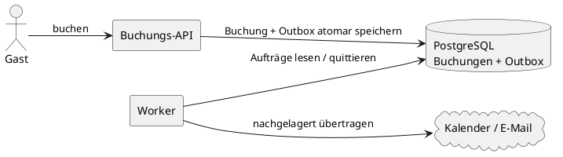
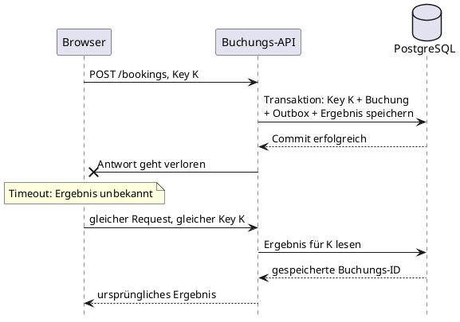
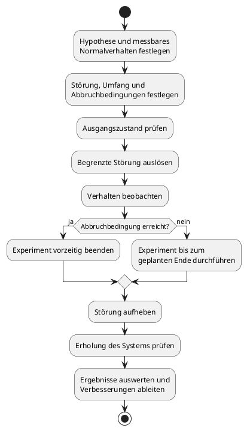

---
title: "Skalierbare Systeme - Resilienz, Fehlertoleranz & Hochverfügbarkeit"
topic: "scalable_systems_1_4"
author: "Lukas Panni"
theme: "metropolis"
fonttheme: "structurebold"
fontsize: 12pt
urlcolor: BrickRed
linkcolor: BrickRed
aspectratio: 169
lang: de-DE
numbersections: true
plantuml-format: svg
toc: true
section-titles: true
...

## Heute

- Zuverlässigkeit aus Nutzersicht messen.
- Fehler begrenzen, bevor sie zur Kaskade werden.
- Hochverfügbarkeit und Recovery entwerfen.
- Resilienz praktisch testen und aus Vorfällen lernen.
- AI Engineering: KI-Komponenten als unzuverlässige Abhängigkeiten.
- Durchgängiges Beispiel: Cal.diy-Terminplattform aus Vorlesung 2.

## Lernziele

- Zuverlässigkeit, Verfügbarkeit, Fehlertoleranz und Resilienz unterscheiden.
- Ein SLI und SLO für einen Anwendungsfall formulieren.
- Fehlerkaskaden erkennen und passende Stabilitätsmuster kombinieren.
- Redundanz, Replikation und Backup voneinander abgrenzen.
- Ein Ausfallszenario bewerten und eine Schutzmaßnahme begründen.

## Unser Szenario: Cal.diy unter Störungen

- Die Buchungsseite erhält ungewöhnlich viele Anfragen
- PostgreSQL und die Buchungs-API sind erreichbar
- Die externe Kalender-API antwortet immer langsamer
- Clients wiederholen fehlgeschlagene Requests
- Die Synchronisationsaufträge sammeln sich; ein Mandant erzeugt besonders viel Last

Leitfrage: Wie bleibt die Buchung nutzbar, ohne Daten zu verlieren oder andere Mandanten mitzuziehen?

## Buchungsfluss und Fehlergrenzen

- Buchung und Outbox-Eintrag werden gemeinsam gespeichert
- Buchungserfolg und externe Synchronisation sind getrennte Zustände
- Die Plattform verwaltet buchbare Slots verbindlich; externe Kalender werden nachgelagert synchronisiert

# Fehler verstehen

## Fehler sind normal

- Wir müssen mit Fehlern rechnen
  - Prozesse stürzen ab
  - Netzwerke verlieren Pakete
  - externe Dienste sind langsam/überlastet/nicht erreichbar
  - Fehler beim Ausrollen neuer Versionen
  - Programmierfehler, Bugs
  - Komplettausfall Infrastruktur

Architekturziel: Nicht jeden Fehler verhindern, sondern seine Auswirkungen kontrollieren.

## Reliability, Availability und Resilienz

| Begriff | Definition |
| --- | --- |
| **Availability** | Ist der Dienst zum benötigten Zeitpunkt nutzbar? |
| **Reliability** | Erfüllt das System seine Funktion über einen Zeitraum korrekt? |
| **Fault Tolerance** | Arbeitet das System trotz bestimmter Fehler weiter? |
| **Resilience** | Begrenzt das System Auswirkungen und erholt sich? |
| **High Availability** | Welche Architektur reduziert ungeplante Nichtverfügbarkeit? |

## Fault, Error, Failure

- **Fault:** Ursache oder Defekt, zum Beispiel ein Fehler in der Prüfung freier Termine.
- **Error:** fehlerhafter interner Zustand, zum Beispiel ein belegter Termin wird als frei geführt.
- **Failure:** von außen sichtbare Abweichung, zum Beispiel eine bestätigte Doppelbuchung.
- Ein Fault führt nicht zwangsläufig zu einem Failure; das System kann den Error erkennen und abfangen.

## Partielle Fehler und Latenz

- Grundlage: verteiltes System, keine strikt monolithische Anwendung
- Ein Teil des Systems funktioniert, während eine andere Komponente langsam oder ausgefallen ist.
- Oft ist unklar, ob eine entfernte Komponente defekt oder nur langsam ist.
- Eine Antwort nach 30 Sekunden kann technisch erfolgreich, für den Nutzer aber unbrauchbar sein.
- Wartende Requests belegen Threads, Verbindungen und Speicher.

Folge: Auch erfolgreiche Aufrufe brauchen eine Zeitgrenze.

## Warum verteilte Systeme scheitern

- Verteilte Systeme sind komplex
- Fehler in einzelnen Komponenten können immer auftreten
- Fehler in Infrastruktur und Netzwerk können immer auftreten
- Zusammenspiel sorgt für unvorhergesehene Effekte^

## Fallacies of Distributed Computing (1/2)

Peter Deutschs Annahmen, die beim Entwurf verteilter Systeme oft falsch sind:

- **The network is reliable:** Pakete können verloren gehen und Verbindungen abbrechen.
- **Latency is zero:** Antworten brauchen Zeit; Timeouts sind nur Grenzwerte.
- **Bandwidth is infinite:** Konkurrenz und Last begrenzen den Durchsatz.
- **The network is secure:** Angriffe und Fehlkonfigurationen sind möglich.

## Fallacies of Distributed Computing (2/2)

- **Topology doesn't change:** Knoten, Routen und Adressen können wechseln.
- **There is one administrator:** Systeme und Regeln liegen oft in verschiedenen Zuständigkeiten.
- **Transport cost is zero:** Übertragung braucht Zeit und Ressourcen.
- **The network is homogeneous:** Protokolle, Systeme und Geräte unterscheiden sich.

## Ausfallarten

- **Crash:** Eine Komponente stoppt.
- **Omission:** Nachrichten werden nicht gesendet oder empfangen (ausgelassen).
- **Timing:** Antworten kommen zu spät oder außerhalb vereinbarter Grenzen.
- **Korrelierte, kaskadierende und metastabile Ausfälle** können lokale Fehler verstärken.

# Zuverlässigkeit messbar machen

## Verfügbarkeit messen

- Eine Prozentzahl ist nur aussagekräftig, wenn _Leistung_ und _Messzeitraum_ festgelegt sind.
- **Zeitbasiert:** Anteil der Zeit, in der der Dienst die vereinbarte Funktion erfüllt.
- **Anfragebasiert:** Anteil erfolgreicher Anfragen; ein anderes SLI als Uptime in Minuten.
- Geplante Wartung zählt nur dann nicht als Ausfall, wenn die Messdefinition sie ausdrücklich ausschließt!

## SLI, SLO und SLA

- **SLI (Service Level Indicator):** gemessene Größe aus Nutzersicht, z.B. Anteil erfolgreicher Buchungen oder Antwortzeit.
- **SLO (Service Level Objective):** Zielwert für ein SLI in einem festgelegten Messfenster, z.B. 99,9 % über 28 Tage.
- **SLA (Service Level Agreement):** vertragliche Vereinbarung mit möglichen Konsequenzen.
- Ein internes SLO sollte ausreichend Puffer zum vertraglichen SLA lassen!

## Die Neunen in Zeit übersetzt

- Annahme: 365 Tage im Jahr, 24/7-Betrieb; geplante Wartung ist nicht ausgenommen.
- **99 %:** <= 3 Tage, 15 Stunden und 36 Minuten
- **99,9 %:** <= 8 Stunden und 46 Minuten
- **99,99 %:** <= 52 Minuten und 34 Sekunden
- **99,999 %:** <= 5 Minuten und 15 Sekunden
- Jede zusätzliche Neun erhöht den Aufwand deutlich!

## MTBF und MTTR

- **MTBF (Mean Time Between Failures):** durchschnittliche Betriebszeit zwischen zwei Ausfällen.
- Längere MTBF bedeutet, dass Ausfälle seltener auftreten; sie beschreibt nicht deren Dauer.
- **MTTR (Mean Time To Repair/Restore):** durchschnittliche Dauer bis zur Wiederherstellung.
- Messbeginn und -ende festlegen, zum Beispiel vom Beginn der Beeinträchtigung bis zur Wiederherstellung.
- Näherung für einen reparierbaren Dienst: $Verfuegbarkeit ≈ MTBF / (MTBF + MTTR)$.
- Bei MTBF 100 Stunden und MTTR 1 Stunde ergibt sich ungefähr 99,0 % Verfügbarkeit.

## Unser Buchungs-SLI: Was zählt als Erfolg?

- **Grundgesamtheit:** eindeutige, gültige _Buchungsabsichten_ für einen _zuvor als frei angezeigten_ Slot.
  - technische Retries zählen nicht erneut
  - Ungültige Eingaben, fehlende Berechtigungen und Health Checks sind ausgeschlossen
- **Gutes Ereignis:** Buchung dauerhaft gespeichert und Bestätigung innerhalb von _2 Sekunden_ zurückgegeben.
- Fehler, Timeout, verspätete oder fehlende Bestätigung zählen als schlecht.
- **Messfenster:** rollierende 28 Tage; mindestens 99,9 % der Buchungsabsichten sollen gut sein

## Fehlerbudget berechnen

- Annahme: In 28-Tagen gibt es 50.000 eindeutige Buchungsabsichten: 49.960 gut, 40 schlecht
  - **SLI:** $49.960 / 50.000 = 99,92 \%$
  - **Fehlerbudget:** höchstens $0,1 \% × 50.000 = 50$ schlechte Buchungen.
- Verbraucht sind 40 von 50 Ereignissen 80 %
- Das Budget zählt Nutzerereignisse, nicht Minuten; ein später Retry macht einen Fehler nicht rückwirkend gut.
- Ein weitgehend verbrauchtes Fehlerbudget ist ein Anlass, Stabilitätsmaßnahmen zu priorisieren und riskante Änderungen zurückzustellen

## Verfügbarkeit verketteter Komponenten

- Sind mehrere Komponenten für eine Anfrage zwingend nötig, müssen alle verfügbar sein.
- Angenommen Ausfälle sind unabhängig voneinander: Multiplikation der Verfügbarkeiten API $99,9 \% × Datenbank 99,9 \% ≈ 99,801 \% Gesamt$.
  - In der Praxis sind Fehler nur selten wirklich unabhängig
  - Gemeinsame Fehlerursachen oder Verstärkung durch Kaskaden reduzieren Gesamtverfügbarkeit deutlich
- Redundanz kann Verfügbarkeit verbessern, beseitigt aber keine gemeinsamen Fehlerursachen.

# Fehlerkaskaden und sichere Wiederholungen

## Vom langsamen Kalender zur Kaskade

1. Die Kalender-API wird langsam
2. Requests warten und belegen Verbindungen
3. Der Verbindungspool der Anwendung läuft voll
4. Clients und Worker wiederholen Aufrufe
5. Last und Queue-Rückstand wachsen
6. Schließlich wird auch die Buchungs-API unbenutzbar

Bleibt ein überlastetes System auch nach Ende des Auslösers instabil, spricht man von einem metastabilen Ausfall.

## Aufgabe: Wo zuerst eingreifen?

**Arbeitszeit: 5 Minuten — 2 allein, 3 zu zweit**

Im Kalender-Szenario:

1. Welche Ressource wird zuerst knapp?
2. Welche Schutzmaßnahme würdet ihr zuerst einsetzen?
3. Was sollte für den Nutzer weiterhin funktionieren?

Ergebnis: eine erste Maßnahme mit kurzer Begründung.

## Timeouts: ein Zeitbudget für den gesamten Request

- Jede Netzwerkoperation braucht Zeit, Timeouts verhindern, dass ein Request unbegrenzt blockiert.
- Beispiel: Für die interaktive Buchung stehen insgesamt 2 Sekunden zur Verfügung
  - Aufrufe, Unteraufrufe und Wiederholungen teilen dieses Budget
  - Verbindungsaufbau und Antwortzeit sind einbezogen
- Verbleibende Deadline an nachgelagerte Dienste weitergeben
- Schwierig: Wahl der Timeouts
  - zu kurz: unnötige Wiederholungen, erzeugen unnötige Last
  - zu lang: blockieren Ressourcen und erhöhen die Latenz

## Wiederholung HTTP Status Codes

- **1xx:** Informational
- **2xx:** Success
- **3xx:** Redirection
- **4xx:** Client Error
- **5xx:** Server Error

## Retries

- Retries sind nur bei transienten (vorübergehenden) Fehlern sinnvoll, zum Beispiel:
  - Netzwerkfehler
  - HTTP 503 Service Unavailable
  - HTTP 429 Too Many Requests (mit `Retry-After`)
- Nicht ohne Änderung wiederholen bei:
  - HTTP 400 Bad Request
  - HTTP 401 Unauthorized
  - HTTP 403 Forbidden
  - HTTP 404 Not Found
  - HTTP 409 Conflict (z.B. Doppelbuchung)
  - HTTP 422 Unprocessable Entity (ungültige Eingabe)
- Status Codes sind nur eine Auswahl. Wichtig ist, dass alle Komponenten sich bei der Semantik der Codes einig sind

## Backoff und Jitter

- **Backoff:** Wartezeit zwischen Wiederholungen, um Lastspitzen zu vermeiden.
  - **Fixed Backoff:** feste Wartezeit, z.B. 2s zwischen jedem Versuch
  - Bei HTTP 429 `Retry-After` berücksichtigen, sofern vorhanden
  - **Linear Backoff:** linear steigende Wartezeit, z.B. 1s, 2s, 3s
  - **Exponential Backoff:** exponentiell steigende Wartezeit, z.B. 1s, 2s, 4s, 8s
- **Jitter:** Wartezeiten zufällig streuen, damit Clients nicht gleichzeitig erneut anfragen
  - Insbesondere bei vielen Clients sinnvoll, ansonsten können sich Lastspitzen zyklisch wiederholen
- Retry nur wenn Operation mindestens idempotent

## Idempotenz macht Wiederholung sicher

- **Idempotent:** Mehrfaches Ausführen derselben Anfrage hat die gleiche beabsichtigte Wirkung wie einmaliges Ausführen
  - Antworten können unterschiedlich sein, z.B. beim wiederholten Löschen
- **Safe:** Die Anfrage fordert keine Änderung des Serverzustands an
  - Beispielsweise Daten lesen; technische Nebenwirkungen wie Logging sind möglich
- Festlegung für den Anwendungsfall und Nutzung der bekannten HTTP Semantik
  - idempotent: GET, PUT, DELETE, HEAD, OPTIONS
  - safe: GET, HEAD, OPTIONS
  - Immer nur bei richtiger Implementierung!
- Beispiel: Buchung stornieren ist idempotent; neue Buchung anlegen nicht ohne weiteres.

## Cal.diy: Timeout bei Buchung

- Buchung per POST and die API
- Die Datenbank bestätigt den Commit, aber die Antwort erreicht den Gast nicht.
- Nach Ablauf des Timeouts zeigt der Browser einen unklaren Status.
- Wie können wir trotz nicht idempotenter HTTP Operation die Aktion als solches korrekt wiederholen?

## Lösung: Idempotency Key

- Der Client erzeugt einen eindeutigen Schlüssel pro Buchungsabsicht
- Die API speichert den Schlüssel zusammen mit dem Ergebnis
- Bei einem Retry kann die API erkennen, ob der Schlüssel bereits verarbeitet wurde und das ursprüngliche Ergebnis zurückgeben
- Erlaubt es auch nicht idempotente HTTP Operationen wie POST sicher zu wiederholen

## Cal.diy: Verlorene Antwort und sicherer Retry

## Idempotency Keys korrekt absichern

- Keys müssen zufällig erzeugt werden und eindeutig sein
- Übereinstimmung mit Idempotency Key in der Datenbank darf vorhandene Sicherheitsüberprüfungen nicht umgehen!
- Auch gleichzeitig eintreffende Requests mit demselben Schlüssel müssen atomar abgesichert werden, z.B. durch einen Unique Constraint und eine Transaktion.
- Prüfen ob die Operation wirklich die gleiche ist, ansonsten ablehnen
- Speichern von Buchung + Schlüssel + Outbox Eintrag muss über Transaktion gesichert werden

## Cal.diy: Wenn Retries den Kalenderausfall verstärken (1)

- Der Kalenderdienst wird langsam; der Outbox Worker wiederholt die Übertragung
  - HTTP-Client im Worker selbst nutz interne Retry-Logik
  - HTTP Proxy der für die Verbindung genutzt wird, hat ebenfalls Retry-Logik
  - **worst case** $3^3 = 27$ Kalenderaufrufe für einen Auftrag
- Jeder Retry erzeugt Last und blockiert Ressourcen
  - Kann Antworten weiter verzögern
  - Queues wachsen und blockieren weitere Aufträge
  - Löst weitere Timeouts auch für andere Clients aus

## Cal.diy: Wenn Retries den Kalenderausfall verstärken (2)

- Besser:
  - Retries an einer einzigen verantwortlichen Stelle bündeln und zusätzliche Versuche insgesamt begrenzen
  - Backoff mit Jitter vermeiden Lastspitzen
  - Insbesondere exponentielles Backoff kann dem System Zeit geben, sich zu erholen

# Fehlerausbreitung und Überlast begrenzen

## Circuit Breaker

- Schutz vor Fehlerkaskaden und übermäßiger Last
- **Closed:** Aufrufe passieren; Fehlerquote oder Timeout-Schwellwert öffnet den Breaker
- **Open:** Aufrufe werden sofort abgewiesen oder auf einen Fallback gelenkt
  - Circuit Breaker kann zentral prüfen, ob der Dienst wieder verfügbar ist und dann die ersten Requests wieder durchlassen
  - **half-open** nur wenige Probeaufrufe zu, wenn Dienst stabil ist, wird der Breaker wieder geschlossen

## Bulkheads: Ressourcen isolieren

- Getrennte Ressourcen-Pools um Fehler zu isolieren
  - isolierte Thread-Pools / Container / VMs / Hosts
  - z.B. Trennung von Kalender-Worker und E-Mail Versand
- Getrennte Pools begrenzen die Auswirkungen einer Überlast
  - Gemeinsam genutzte Ressourcen können weiterhin zum Engpass werden
- Ausfälle können auf einzelne Systemteile begrenzt werden
- Aufteilung der Ressourcenpools können wichtige Systemteile bevorzugen
- ABER: Ressourcen werden nicht so effizient genutzt

## Backpressure: Erzeuger bremsen

- Grundlegendes Prinzip zur Synchronisation von Sender (producer) und Empfänger (consumer)
  - Problem: producer erzeugt schneller als consumer verarbeiten kann und sort dort für hohe Last und Rückstau
- **Lösung**: consumer steuert Interaktion
  - Pull-Prinzip: consumer fordert aktiv Daten an, producer liefert nur so viel wie angefordert
  - Buffer: producer schreibt in beschränkten Buffer, consumer liest daraus, wenn Buffer voll kann producer drosseln oder pausieren
  - Drop-Prinzip: consumer kann bei voller Queue Aufträge verwerfen oder ablehnen. Nur wenn fachliche Bewertung es erlaubt

## Rate Limits & Quotas

- **Rate Limits:** Begrenzen von Anfrage
  - z.B. pro User, pro IP-Adresse, pro Funktion ...
  - Auch als Schutz vor übermäßigen Kosten und Missbrauch -> z.B. LLM Tokens
  - Verschiedene Rate-Limit-Strategien: Token Bucket, Fixed Window, Sliding Window
  - Strategien sind haben verschiedene Vor- und Nachteile und sind abhängig von der Art der Last (z.B. gleichmäßig vs. bursts)
- **Quotas:** Allgemeinere Ressourcen-Kontingente
  - z.B. Speicherplatz, CPU-Zeit
  - Oft über längere Zeiträume (z.B. pro Tag, pro Monat) und nicht nur kurzfristig wie Rate Limits
  - Durchsetzen von Abo-Stufen und allgemeine Fairness

## Load Shedding

- **Load Shedding:** weniger wichtige Anfragen geziehlt ablehnen, um Kernfunktionalität zu schützen
  - Hauptfunktion bleibt so lange wie möglich verfügbar oder wichtigste Kunden können weiterhin bedient werden
  - z.B. Analyse, Reporting, Hintergrundjobs zuerst ablehnen um Ressourcen für Kernfunktion zu schützen
  - Komplex: aktuelle Last messen/einschätzen, Prioritäten bestimmen

## Graceful Degradation

- System fällt nicht komplett aus, sondern reduziert Funktionalität
  - ähnlich wie Load Shedding, oft aber vorgelagert
    - Keine aktive Ablehnung von Anfragen, sondern Reduktion der Qualität
    - Abschaltung von optionalen Features
  - z.B. UI reduziert Aktualisierungshäufigkeit, um Datenbank zu schonen

## Stabilitätsmuster in der Praxis

Beispiel: Die Kalender-API wird langsam – Buchungen sollen weiterhin möglich sein.

- **Entkopplung:** Buchung und Outbox-Eintrag gemeinsam speichern
  - Kalender nachgelagert synchronisieren; Buchung wartet nicht darauf
- **Timeout + Circuit Breaker:** Wartezeit begrenzen und eine gestörte Abhängigkeit vorübergehend nicht mehr aufrufen
- **Begrenzte Retries + Backoff + Jitter:** Synchronisation später erneut versuchen
  - Idempotenz verhindert doppelte Kalendereinträge
- **Bulkheads + Lastbegrenzung:** Worker-Ressourcen und parallele Aufrufe begrenzen
  - Gemeinsame Ressourcen wie Datenbankverbindungen dürfen nicht ausgeschöpft werden
- **Graceful Degradation:** Buchung bestätigen, Synchronisation als ausstehend anzeigen

Die Muster ergänzen sich: Entkopplung allein verhindert noch keine Überlast.

# Hochverfügbarkeit durch Redundanz

## High Availability

- Ziel: (weitgehend) unterbrechungsfreier Betrieb des Systems auch bei Ausfällen
- Verfügbarkeitsziel "x nines" (99,9 %, 99,999 %)
- Redundanz + Fehlertoleranz/Fehlererkennung + kein Single Point of Failure
- Wiederholung CAP Theorem:
  - Bei einer Netzwerkpartition lassen sich strikte Konsistenz und Verfügbarkeit aller betroffenen Operationen nicht gleichzeitig garantieren
  - Beispiel: Buchungen vorübergehend ablehnen, statt widersprüchliche Belegungen zu bestätigen

## Single Point of Failure & Failure Domains

- Nicht jede Komponente ist gleich wichtig
  - Ausfall bestimmer Komponenten kann aber das gesamte System stoppen -> **Single Point of Failure** (SPoF)
- SPoF typischerweise: Datenbank, einzelner App-Server
- ABER: auch DNS, Internetanbindung etc. können problematisch sein.
- **Failure Domain**: physicher/logischer Bereich, der von einem einzelnen HW oder Softwarefehler betroffen ist
  - z.B. einzelner Server, komplettes Netzwerksegment, ganzes Rechenzentrum
  - Auswirkungen sind vom Systemdesign abhängig!

## Aufgabe: Failure Domains

**Arbeitszeit: 5 Minuten — 2 allein, 3 zu zweit**

Zwei App-Instanzen stehen im selben Rechenzentrum und nutzen denselben Load Balancer:

1. Gegen welche Ausfälle helfen die zwei Instanzen?
2. Welche gemeinsamen Ausfälle bleiben möglich?

## Redundanz

- **Redundanz**: Zusätzliche Systeme/Server/Komponenten, können im Fehlerfall übernehmen
  - Verschiedene Ebenen: Prozesse, Container/Pods, Hosts, Regionen
  - Abhängig von Ausfallsicherheitsanforderungen
- Zustandslose Services lassen sich leichter replizieren
  - Keine Synchronisation von Datenzugriffen notwendig
  - Schneller Startzeiten möglich
  - Generell: je weniger Zustand, desto einfacher

## Redundanz Active-Active

- mehrere Replikate sind gleichzeitig aktiv und teilen die Last
  - Sehr schnelle Umschaltzeit
  - Komplexität durch Synchronisierung und Datenkonsistenz
  - bestehende Replikate müssen potenziell mit mehr Last umgehen können
  - Beispiel: zwei Instanzen, eine Fällt aus -> eine Instanz muss alleine die Last bewältigen können

## Redundanz Active-Passive

- "Standby" Redundanz
- Primärsystem bearbeitet im Normalbetrieb alle Anfragen
- Sekundärsystem (für 1:1 Ersatz identisch) ist im Normalbetrieb aus bzw. im Standby
  - Springt im Fehlerfall ein
  - höhere Umschaltzeiten als Active-Active
  - Im Normalbetrieb nur ein schreibendes Primärsystem
    - Vereinfacht die Koordination von Schreibzugriffen
  - Beim Umschalten können durch Replikationsrückstand Änderungen fehlen
  - Das bisherige Primärsystem darf nach dem Failover nicht unkontrolliert weiterschreiben
  - Verschiedene Umsetzungsmöglichkeiten: Hot/Warm/Cold -> wie aktiv ist das System, wie aktuell die Daten

## Failover

- Für Umschaltung auf redundante System ist Erkennung von Ausfall notwendig -> **Failover**
- Passive Überwachung durch Load-Balancer / Proxy: erkennen von hohen Timeouts, ausbleibenden Antworten
- *_Heartbeat_: regelmäßiges kurzes Signal, dass System aktiv ist
  - Heißt aber nicht unbedingt, dass das System auch voll funktionsfähig ist!
  - Kann um detailliertere Healthcheck-Informationen erweitert werden
  - n verpasste Heartbeats als Schwelle zum Umschalten
- Ausbleibende Heartbeats sind nicht unbedingt ein Ausfall des Systems, Ausfall des Netzwerks oder des Heartbeat-Services sind auch möglich!

## Split Brain

- Verteiltes System teilt sich in voneinander isolierte Teilsysteme
  - z.B. fehlerhaft ein Ausfall diagnostiziert und redundantes System aktiv ohne Kommunikation zwischen beiden
- Beide Teilsysteme (theoretisch auch mehr als 2, aber sehr unwahrscheinlich) wissen nichts voneinander und greifen schreibend ohne synchronsiation auf gleiche Daten
- Datenkonsistenz wird nicht mehr sichergestellt
- Bei Wiederherstellung der Kommunikation müssen Konflikte aufgelöst werden, das ist nicht immer ohne Datenverlust möglich
- **Fencing:** Ein alter oder isolierter Primärknoten wird zuverlässig von weiteren Schreibzugriffen ausgeschlossen
  - Beispielsweise durch Entzug des Speicherzugriffs oder Abschalten des Knotens
- Auswirkungen abhängig von Datenarchitektur!

## Zusammenspiel mit Datenarchitektur

- Datenmodell, Aufteilung der Daten nach Services, Replikation + Sharding haben große Auswikrungen auf High Availability
- Einige Entscheidungen in der Datenarchitektur können HA erleichtern oder erschweren
- Teil-Ausfälle eines Systems können dafür sorgen dass temporär veraltete Daten vorhanden sind oder sogar Daten verloren gehen

# Wiederherstellung nach schweren Ausfällen

## Disaster Recovery

- Strategien, Prozesse, Werkzeuge zur Wiederherstellung nach einem schwerwiegenden Ausfall
  - Ziel: Business Continuity
- **RTO (Recovery Time Objective):** maximal akzeptable Wiederherstellungsdauer.
- **RPO (Recovery Point Objective):** maximal akzeptabler Datenverlust, ausgedrückt als Zeitspanne.
- Disaser Recovery kommt zum Einsatz wenn High Availability / Redundanz nicht mehr reicht
  - Große Ausfälle z.B. ganz Rechenzentren, Cloud-Regionen
  - Naturkatastrophen
  - Cyberangriffe
- Nicht immer ohne Datenverlust möglich

## Backup

Ohne Backup kein Disaster Recovery!  

**3-2-1 Regel**

- 3 Kopien der Daten
- 2 verschiedene Medien
- 1 Offsite Backup

Replikation ersetzt kein Backup und umgekehrt.

## Disaster Recovery Umsetzung

Je nach Anforderungen und Budget kann Infrastruktur wie bei Replikation auch, schon vorhanden sein -> eine Art der Active-Passive Redundanz, idR aber keine automatische Umschaltung sondern menschliches Eingreifen.
(Je nach Auslegung kann auch ein Active-Active System als Maßnahme zur Disaster Recovery eingestuft werden)

- Wichtig sind klare Prozesse, Zuständigkeiten und dokumentiertes Vorgehen
- DR Pläne müssen regelmäßig geübt werden

## Failover oder Restore?

| Situation | Erster möglicher Pfad | Zu prüfender Trade-off |
| --- | --- | --- |
| Host ausgefallen, Daten intakt | Replica-Failover | Lag und mögliche Schreibverluste. |
| Daten versehentlich gelöscht | Point-in-time Restore | RTO und Umfang verlorener Änderungen. |
| Region verloren | Disaster-Recovery-Standby | Kosten, Umschaltung und Datenstand. |
| Schaden wird repliziert | Isoliertes Backup | Wiederherstellung und saubere Umgebung. |

Failover stellt den Dienst wieder bereit; Restore stellt einen früheren Datenstand wieder her.

# Resilienz überprüfen

## Funktionieren unsere Schutzmaßnahmen?

- Bisher haben wir Schutzmaßnahmen entworfen
  - Timeouts, Retries, Circuit Breaker, Ressourcen-Isolation und Redundanz
- Ob sie zusammenspielen, zeigt sich erst unter Last und bei Fehlern
  - Ein Circuit Breaker kann zu spät öffnen
  - Ein Retry kann einen bereits erfolgreichen Vorgang wiederholen
  - Ein Ersatzsystem kann für die zusätzliche Last zu klein sein
- Tests prüfen konkrete Erwartungen
  - Bleiben Buchungen möglich?
  - Bleiben Daten korrekt?
  - Erholt sich das System nach der Störung?

Ziel: Schwachstellen finden, bevor sie im regulären Betrieb auftreten.

## Lasttests: Welche Grenze suchen wir?

- **Lasttest:** Verhalten unter erwarteter Last prüfen
  - Beispiel: viele gleichzeitige Buchungsanfragen zur Freigabe neuer Termine
- **Stresstest:** Last über den erwarteten Bereich hinaus steigern
  - Wo entsteht der Engpass?
  - Lehnt das System kontrolliert ab oder bricht es zusammen?
- **Soak-Test:** Last über einen längeren Zeitraum aufrechterhalten
  - Werden Speicher oder Verbindungen dauerhaft belegt?
  - Wachsen Rückstände langsam an?

Beobachten: Erfolgsrate, Antwortzeiten, Ressourcenauslastung und Queue-Rückstand.

## Fehler gezielt auslösen

- **Fault Injection:** Fehlerbedingungen kontrolliert herbeiführen
  - Verhalten prüfen, das im normalen Testlauf selten auftritt
- Beispiele für Cal.diy:
  - Kalender-API antwortet langsam → greifen Timeout und Circuit Breaker?
  - Antwort nach erfolgreicher Buchung geht verloren → verhindert der Retry eine zweite Buchung?
  - Worker stürzt während der Verarbeitung ab → wird der Auftrag sicher erneut verarbeitet?
- Erwartetes Verhalten vor dem Test festlegen
  - Technischer Fehler darf keine fachlich ungültigen Daten erzeugen
- Auch nach Ende der Störung beobachten
  - Baut sich der Rückstand ab oder bleibt das System überlastet?

## Chaos Engineering

- **Chaos Engineering:** Annahmen über das System durch kontrollierte Experimente überprüfen
  - Besonders relevant für das Zusammenspiel mehrerer Komponenten
- Vorgehen:
  1. Messbares Normalverhalten und Hypothese festlegen
  2. Realistische Störung auswählen
  3. Betroffenen Bereich und Abbruchbedingungen begrenzen
  4. Störung auslösen und Auswirkungen beobachten
  5. Störung beenden, Erholung prüfen und Ergebnisse auswerten
- Klein beginnen, zunächst in einer geeigneten Testumgebung
  - Experimente im Produktivbetrieb brauchen zusätzliche Absicherung

Fault Injection ist eine Technik; die überprüfbare Hypothese macht daraus ein Experiment.

## Ablauf eines Chaos-Experiments

Auch ein abgebrochenes Experiment liefert Erkenntnisse über die Grenzen des Systems.

## Beispiel: Cal.diy bei Kalenderausfall

- **Hypothese:** Ein Kalenderausfall beeinträchtigt die Buchung nicht
  - Unter definierter Testlast werden gültige Buchungen innerhalb von 2 Sekunden bestätigt
- **Störung:** Kalenderzugriff für 5 Minuten unterbrechen
  - Nur die Testumgebung ist betroffen
- **Währenddessen prüfen:**
  - Buchungen bleiben gespeichert; Synchronisation wird als ausstehend angezeigt
  - Circuit Breaker öffnet; Worker schöpfen gemeinsame Ressourcen nicht aus
- **Abbruch:** Datenfehler oder anhaltende Überschreitung der festgelegten Last- und Latenzgrenzen
- **Nach Ende der Störung:**
  - Synchronisation läuft wieder an und der Rückstand sinkt
  - Keine verlorenen Aufträge oder doppelten Kalendereinträge

Das 28-Tage-SLO bleibt eine Betriebskennzahl; das Experiment prüft ein begrenztes Szenario.

## Wiederherstellung testen

Ein erfolgreiches Backup oder eine vorhandene Replica beweist noch keine Wiederherstellbarkeit.

- **Failover üben:** Primärsystem kontrolliert ausfallen lassen
  - Übernimmt das Ersatzsystem und funktionieren Buchungen wieder?
- **Restore üben:** Backup in einer isolierten Testumgebung wiederherstellen
  - Anwendung starten und vorhandene sowie neue Buchungen prüfen
- **RTO überprüfen:** Zeit vom Ausfall bis zur nutzbaren Anwendung messen
  - Erkennung, Entscheidung, Wiederherstellung und Prüfung zählen mit
- **RPO überprüfen:** Wiederhergestellten Datenstand mit dem Zustand vor dem Ausfall vergleichen
  - Welche zuletzt gespeicherten Buchungen fehlen?
- **Folgezustände prüfen:** Passen Buchungen, Outbox und externe Kalender zusammen?
  - Erneute Verarbeitung darf keine doppelten Einträge erzeugen

Ergebnisse dokumentieren, Wiederherstellungsplan verbessern und regelmäßig erneut testen.

# Aus Vorfällen lernen

## Fallbeispiel: GitHub-Ausfall im Oktober 2018

Wie werden aus 43 Sekunden Netzwerkunterbrechung über 24 Stunden beeinträchtigter Betrieb?

- Wartungsarbeiten unterbrechen eine Netzwerkverbindung zum primären Rechenzentrum an der US-Ostküste
- Die automatische Failover-Steuerung aktiviert Datenbanken an der US-Westküste als neue Primärsysteme
- Nach Wiederherstellung der Verbindung enthalten beide Seiten Änderungen, die auf der jeweils anderen fehlen
  - Ein einfaches Zurückschalten ist nicht sicher möglich
- Die veränderte Datenbanktopologie verursacht zusätzliche Latenz und Anwendungsprobleme

Die Netzwerkverbindung ist wiederhergestellt – der Dienst noch nicht.

## GitHub: Wiederherstellung und Lehren

- **Datenintegrität vor schneller Umschaltung**
  - Auseinandergelaufene Datenbestände erschweren die Rückkehr zur ursprünglichen Topologie
- **Recovery braucht Zeit**
  - Große Datenbestände müssen wiederhergestellt und Replikationsrückstände aufgeholt werden
- **Ein behobener Auslöser beendet nicht alle Folgen**
  - Aufgestaute Webhooks und andere Hintergrundaufträge müssen nachgearbeitet werden
- **Failover muss zur Anwendung passen**
  - Eine technisch mögliche Datenbanktopologie ist nicht automatisch für die Anwendung geeignet

Lehre: Auch automatische Schutzmaßnahmen können einen Ausfall verschärfen, wenn ihre Annahmen nicht stimmen.

Quelle: [GitHub: October 21 post-incident analysis](https://github.blog/news-insights/company-news/oct21-post-incident-analysis/)

## Während und nach einem Vorfall

- **Incident:** Störung, die den regulären Betrieb beeinträchtigt
- **Währenddessen: Auswirkungen begrenzen und Betrieb stabilisieren**
  - Betroffene Funktionen und Nutzer bestimmen
  - Zuständigkeiten klären und Maßnahmen koordinieren
  - Beispielsweise fehlerhaftes Deployment zurückrollen oder optionale Funktionen abschalten
- **Danach: Ablauf und Ursachen nachvollziehen**
  - Was hat den Vorfall ausgelöst?
  - Welche Bedingungen haben ihn verstärkt?
  - Warum haben Schutzmaßnahmen nicht ausreichend geholfen?

Eine vollständige Ursachenanalyse darf die Wiederherstellung nicht unnötig verzögern.

Incident Management und Observability werden in Vorlesung 6 vertieft.

## Postmortem: Aus dem Vorfall Verbesserungen ableiten

- **Postmortem:** strukturierte Auswertung nach einem relevanten Vorfall
  - Auswirkungen, Zeitlinie, beitragende Faktoren und Maßnahmen dokumentieren
- **Blameless:** Abläufe und Rahmenbedingungen untersuchen, statt Schuldige zu suchen
  - „Menschlicher Fehler“ erklärt noch nicht, warum der Fehler möglich war
- Maßnahmen konkret und überprüfbar formulieren
  - Verantwortliche und Termin festlegen
  - Umsetzung und Wirksamkeit nachverfolgen

Beispiel:

- Beobachtung: Kalender-Worker belegen alle Datenbankverbindungen
- Maßnahme: Worker-Verbindungen begrenzen und Kapazität für die Buchungs-API reservieren
- Nachweis: Kalenderausfall unter Last erneut testen

# Transfer: Resilienz für KI-Komponenten

## Modell-APIs als externe Abhängigkeit

Erweiterung unseres Cal.diy-Lehrmodells: Eine optionale KI formuliert Terminbeschreibungen.

- Modell-APIs können langsam, überlastet oder nicht erreichbar sein
  - Grundsätzlich gelten die bereits bekannten Stabilitätsmuster
- **Timeout:** Wartezeit auf die Generierung begrenzen
- **Begrenzte Retries:** vorübergehende Fehler mit Backoff und Jitter behandeln
  - Vorhandene Retry-Logik im SDK berücksichtigen
- **Circuit Breaker und Ressourcen-Isolation:** Störungen der KI dürfen die Buchungs-API nicht überlasten
- **Budgets:** Versuche, Tokens und Kosten begrenzen

Die Buchung darf nicht vom Erfolg der optionalen Textgenerierung abhängen.

## Technisch erfolgreich, inhaltlich unbrauchbar

- Eine erfolgreiche HTTP-Antwort garantiert kein brauchbares Ergebnis
  - Beschreibung enthält erfundene Angaben
  - Ausgabe hat ein falsches Format oder fehlt
  - Modell lehnt die Anfrage ab
- **Formale Prüfung:** Ist das Ergebnis technisch verarbeitbar?
  - Erwartete Felder, Datentypen und Längen prüfen
- **Fachliche Prüfung:** Passt der Inhalt zu den Eingaben?
  - Korrektes JSON garantiert keine korrekten Aussagen
- Cal.diy: Generierten Text als bearbeitbaren Vorschlag anzeigen
  - Nutzer prüft und übernimmt ihn ausdrücklich

Technische Erfolgsrate und inhaltliche Qualität müssen getrennt betrachtet werden.

## KI-Retries: Wann hilft ein neuer Versuch?

- **Vorübergehender technischer Fehler:** begrenzt erneut versuchen
  - Beispielsweise bei Überlastung; `Retry-After` berücksichtigen
- **Ungültiges Format:** Ausgabe ablehnen oder gezielt korrigieren lassen
  - Auch die korrigierte Ausgabe erneut validieren
- **Falscher Inhalt:** Ein identischer neuer Aufruf garantiert keine Verbesserung
  - Manuelle Korrektur kann sinnvoller sein
- **Verweigerung:** als möglichen Ausgang behandeln
  - Keine automatische Wiederholungsschleife zur Umgehung
- Alle Versuche teilen ein Zeit- und Kostenbudget
  - Auch ein Aufruf ohne empfangene Antwort kann bereits verarbeitet worden sein

Erneut versuchen ist eine bewusste Entscheidung, kein universeller Fallback.

## Graceful Degradation mit KI

- Bei Ausfall oder unbrauchbarer Ausgabe bleibt die manuelle Eingabe verfügbar
  - Bereits eingegebene Inhalte bleiben erhalten
  - Die Buchung kann ohne KI abgeschlossen werden
- Nutzer klar informieren
  - „Textgenerierung aktuell nicht verfügbar. Du kannst die Beschreibung selbst eingeben.“
- Gestörte KI-Funktion bei Bedarf gezielt deaktivieren
  - Beispielsweise über einen Feature Flag
- Auch diesen Ausweichpfad testen
  - Timeout, Überlastung und ungültige Ausgabe simulieren
  - Prüfen, ob die Buchung weiterhin funktioniert

Resilienz bedeutet hier: Die Zusatzfunktion darf ausfallen, die Kernfunktion bleibt nutzbar.

# Zusammenfassung

## Zuverlässigkeit gezielt entwerfen

- **Nutzerziele festlegen:** Was muss korrekt und rechtzeitig funktionieren?
  - SLI misst das Verhalten; SLO und Fehlerbudget machen Ziele überprüfbar
- **Fehler begrenzen:** Zeit, Wiederholungen und Ressourcen sind endlich
  - Timeouts, sichere Retries und Isolation verhindern Fehlerkaskaden
- **Weiterbetrieb ermöglichen:** Redundanz schützt vor bestimmten Ausfällen
  - Gemeinsame Fehlerursachen und ausreichende Ersatzkapazität berücksichtigen
- **Wiederherstellung planen:** Replikation ersetzt kein Backup
  - RTO und RPO bestimmen Anforderungen an die Recovery

Die Maßnahmen müssen zu den Nutzerzielen und den erwarteten Ausfällen passen.

## Zurück zu Cal.diy: Was bleibt bei Störungen möglich?

- **Kalender-API ausgefallen:** Buchung bleibt möglich
  - Buchung und Outbox werden gemeinsam gespeichert; Synchronisation folgt später
- **Buchungsantwort verloren:** Wiederholung liefert das ursprüngliche Ergebnis
  - Idempotency Key verhindert eine zweite Buchung
- **Ein Mandant erzeugt zu viel Last:** Andere Mandanten bleiben geschützt
  - Rate Limits und Ressourcen-Isolation begrenzen die Auswirkungen
- **Datenbank ausgefallen oder Daten beschädigt:** Passenden Recovery-Pfad wählen
  - Je nach Schaden Failover oder Wiederherstellung aus Backup
- **Optionale KI nicht verfügbar:** Beschreibung manuell eingeben
  - Die Kernfunktion bleibt ohne KI nutzbar

## Resilienz muss überprüft werden

- **Unter Last testen:** Wo entstehen Engpässe und wie reagiert das System?
- **Fehler gezielt auslösen:** Greifen die Schutzmaßnahmen wie erwartet?
- **Erholung beobachten:** Baut sich der Rückstand nach der Störung wieder ab?
- **Wiederherstellung üben:** Werden RTO, RPO und Datenkorrektheit eingehalten?
- **Aus Vorfällen lernen:** Ursachen verstehen, Maßnahmen umsetzen und erneut prüfen

Resilienz ist keine einzelne Technologie, sondern das Zusammenspiel von Architektur, Implementierung und Betrieb.

## Nächste Vorlesung

- Architekturstile (Silas).

# Literatur und Quellen

## Literaturhinweise

- Nygard: _Release It!_, 2. Auflage — Stabilitätsmuster und Anti-Patterns.
- Beyer et al.: _Site Reliability Engineering_ — SLOs, Fehlerbudgets und Überlast.
- Kleppmann, Riccomini: _Designing Data-Intensive Applications_, 2. Auflage — Replikation und verteilte Systeme.
- Google: _Building Secure and Reliable Systems_ — Resilienz und Recovery.

## Frei verfügbare Quellen

- [Google SRE Book](https://sre.google/sre-book/table-of-contents/).
- [Google SRE Workbook](https://sre.google/workbook/table-of-contents/).
- [Building Secure and Reliable Systems](https://google.github.io/building-secure-and-reliable-systems/raw/toc.html).
- [Cal.com Webhooks](https://cal.com/docs/developing/guides/automation/webhooks).
