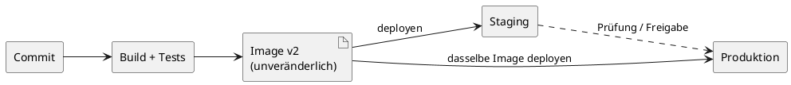

---
title: "Skalierbare Systeme - Betrieb, Observability & Deployment"
topic: "scalable_systems_1_6"
author: "Lukas Panni"
theme: "metropolis"
fonttheme: "structurebold"
fontsize: 12pt
urlcolor: BrickRed
linkcolor: BrickRed
aspectratio: 169
lang: de-DE
numbersections: true
plantuml-format: svg
toc: true
section-titles: true
...

<!--
Time plan: 4 VE = 180 min content; 15 min break separately.
  Einstieg und Rückblick                   15
  Eine Änderung sicher ausliefern          40
  Risiko beim Rollout begrenzen            45
  Auswirkungen sichtbar machen             40
  Incident und Lernschleife                20
  Transfer: KI im Betrieb                  15
  Zusammenfassung                           5
  Sum                                     180
  Short tasks and plenum discussions included in the sections above.
-->

# Einstieg und Rückblick

## Heute: Eine Änderung geht live

- Cal.diy-Lehrmodell: Buchung, PostgreSQL, Outbox und Kalender-Worker
- Neu: interne Notiz zu einer Buchung
- Lokal funktioniert alles – was passiert beim Ausrollen?
- Weg: **prüfen → ausliefern → beobachten → eingreifen → lernen**

<!-- Dozent: Die Notiz und der folgende Vorfall sind fiktiv; keine Aussage über die reale Cal.diy-Implementierung. -->

## Was wir schon wissen (Vorlesungen 2 und 4)

- **V2:** Die Datenbank verhindert Doppelbuchungen; Mandantengrenzen gelten auch für neue Felder.
- **V4:** Buchung + Outbox atomar; Kalender-Sync läuft nachgelagert.
- **V4:** SLI = Anteil gültiger Buchungsabsichten mit Bestätigung innerhalb von 2 s.
- **V4:** SLO = mindestens 99,9 % in rollierenden 28 Tagen.

<!-- Selbststudium: Für SLI und Fehlerbudget die Folien „Unser Buchungs-SLI“ und „Fehlerbudget berechnen“ in Vorlesung 4 wiederholen. -->

## Lernziele

- Eine Änderung als geprüftes Artefakt bis zur Produktion verfolgen
- Rollout und Datenbankschema kompatibel gestalten
- Nutzerwirkung mit Metriken, Logs und Traces untersuchen
- Auf einen Incident reagieren und eine Verbesserung ableiten
- Zwischen Sicherheit, Tempo und Betriebskosten abwägen

# Eine Änderung sicher ausliefern

## Problem: „Läuft bei mir“ genügt nicht

- Neue Notizspalte; mehrere App-Instanzen laufen parallel
- Die alte Version kennt die Spalte noch nicht
- Ein fehlerhafter Build könnte alle Buchungen betreffen
- Ziel: **reproduzierbar prüfen, genau das Geprüfte ausliefern**

## CI, Delivery, Deployment

- **Continuous Integration:** häufig integrieren, automatisch bauen und testen
- **Continuous Delivery:** geprüfte Version jederzeit auslieferbar halten
- **Continuous Deployment:** jede erfolgreiche Änderung automatisch produktiv setzen
- Automatik spart Wartezeit; riskante Freigaben dürfen bewusst manuell bleiben

## Ein Artefakt, mehrere Umgebungen



- Tests: fachliche Buchungsregel, Datenbankintegration, wichtiger Nutzerfluss
- Bei Fehler abbrechen; Version und Testergebnis nachvollziehbar halten
- Secrets erst zur Laufzeit bereitstellen – nie ins Image

<!-- Dozent: Verbindung zu Vorlesung 2: Der Integrationstest muss die DB-Regel gegen Doppelbuchungen wirklich ausführen. Safety-Scans und Reviews sind weitere Gates, aber kein Ersatz für fachliche Tests. -->

## Was testet die Pipeline – und was nicht?

| Prüfung | Fängt ab | Fängt nicht sicher ab |
|:--|:--|:--|
| Unit-Test | Fehler in Notizlogik | echte DB-Konflikte |
| Integrationstest | Migration + Buchungsregel | Produktionslast |
| Staging-Flow | Notiz speichern und lesen | reale Traffic-Verteilung |
| Canary | Probleme unter echter Last | seltene Fehler bei 100 % |

**Best Practice:** schnelle Checks zuerst, kritische Nutzerpfade vor dem Rollout.

## Aufgabe: Wo gehört die Prüfung hin? (5 Minuten)

- Alte und neue App greifen gleichzeitig auf Buchungen zu.
- Ein doppelter Slot darf niemals bestätigt werden.
- Eine neue Notiz darf nicht bei fremden Mandanten auftauchen.
- Zu zweit: Welche Prüfungen vor Produktion? Was erst im Canary sichtbar?

<!-- Dozent: Im Plenum DB-Constraint/Integrationstest, mandantenübergreifenden Zugriffstest und Signal für reale Last sammeln. Tests und Monitoring ergänzen sich. -->

## Migration: alte und neue Version gleichzeitig

- `internal_note` zunächst **nullable** ergänzen: alte App bleibt lauffähig
- v2 deployen; Notiz nur für berechtigte Nutzer freigeben
- Für die optionale Notiz: kein Backfill und kein Entfernen alter Felder nötig
- Code-Rollback auf v1 bleibt möglich; die neue Spalte bleibt bestehen

<!-- Dozent: Bei einem späteren Spaltenersatz wären Backfill und Contract nötig. Alte Felder erst entfernen, wenn weder laufende noch als Rückweg vorgesehene Versionen sie lesen oder schreiben. -->

## Deployment ist nicht Release

- **Deployment:** v2 läuft technisch; **Release:** Notiz ist sichtbar
- Feature Flag: Notiz zunächst nur für ein internes Team
- Abschalten geht schnell – bereits geschriebene Daten bleiben
- Preis: zusätzliche Zustände; Flags mit Besitzer und Löschtermin

# Risiko beim Rollout begrenzen

## Problem: v2 ist getestet – aber wie viel Risiko?

- Produktivlast und Staging unterscheiden sich
- Rollout betrifft gleichzeitig API, Datenbank und Worker
- Ein schneller Rückweg zählt mehr als ein schönes Dashboard
- Vorab festlegen: **Was stoppt den Rollout? Wer entscheidet?**

## Strategien im Vergleich

| Strategie | Vorteil | Nachteil |
|:--|:--|:--|
| Recreate | einfach | Unterbrechung |
| Rolling | wenig Zusatzkapazität | Versionen überlappen |
| Blue/Green | schneller Traffic-Wechsel | doppelte Umgebung; DB bleibt geteilt |
| Canary | kleiner Auswirkungsbereich | Traffic-Routing und Messung nötig |

**Für unsere Änderung:** Canary, falls Traffic und Versionen getrennt messbar sind; sonst Rolling mit schnellem Stopp.

## Canary: erst messen, dann erweitern

```text
10 % v2 -> messen -> Go/Stop -> 50 % -> erneut prüfen -> 100 %
                         |
                      Stop: zurück zu v1
```

- Wenige Nutzer zuerst: kleiner Auswirkungsbereich, aber wenig Messdaten
- v1 und v2 getrennt und bei vergleichbarem Traffic beobachten
- Nicht „grün“, nur weil die Gesamtfehlerquote stabil bleibt

<!-- Dozent: Kleine Canarys übersehen seltene Fehler. Bei wenig Traffic länger beobachten; v2 kann einen anderen Nutzermix erhalten als v1. -->

## Go/Stop-Gate für Cal.diy

- **Vorab:** 15 Minuten und mindestens 200 Buchungsabsichten je Version
- **Stop:** p95 von v2 > 1,5 × v1 oder Pool-Wartezeit p95 > 200 ms
- **Go:** Grenzen eingehalten, Buchungs-SLI stabil; sonst pausieren
- **Verantwortung:** Release-Team entscheidet; bei zu wenig Traffic weiter warten

<!-- Dozent: Beispielwerte, keine universellen Grenzwerte. Buchungs-SLI und DB-Fehler je Version prüfen; wenige hundert Ereignisse beweisen kein 99,9-%-SLO. Die eindeutige Buchungsabsicht aus V4 zählt nur einmal, auch bei technischen Retries. Bei akutem Buchungsausfall unabhängig vom Messfenster stoppen. -->

## Health Checks sind nicht das SLO

- **Liveness:** hängt der Prozess? Neustart nur dann sinnvoll
- **Readiness:** kann diese Instanz jetzt Traffic annehmen?
- „HTTP 200“ sagt nichts über erfolgreiche Buchungen
- Falsche Readiness kann alle Instanzen gleichzeitig aus dem Traffic nehmen

<!-- Bezug Vorlesung 4: Health Checks helfen beim Failover; das Buchungs-SLI misst Nutzerwirkung. -->

## Orchestrierung und Kosten: nur so viel wie nötig

- Mehr Instanzen brauchen Platz, Neustart und Traffic-Routing
- Managed Service oder PaaS: weniger Eigenbetrieb; weniger Kontrolle
- Kubernetes: flexible Rollouts; zusätzliche Komplexität und Kosten
- Autoscaling hilft bei Last, **nicht** bei blockierter DB oder Fehlkonfiguration

<!-- Dozent: Datenbankverbindungen wachsen oft mit der Instanzzahl. IaC und GitOps sind nützlich für reproduzierbare Infrastruktur, aber kein notwendiger Einstieg für das Lehrbeispiel. -->

## Aufgabe: Rollout-Entscheidung (6 Minuten)

- v2 erhält 10 % Traffic; p95 ist doppelt so hoch wie bei v1.
- Gesamtfehlerquote bleibt fast unverändert.
- v2 belegt doppelt so viele DB-Verbindungen.
- In Dreiergruppen: weiterrollen, pausieren oder zurück? Welche zwei Signale fehlen?

<!-- Dozent: Erwartung: pausieren, nicht auf 50 % gehen; Buchungs-SLI nach Version und DB-Pool-Wartezeit/Queries prüfen. Rollback nur bei kompatiblem Schema und sicherem Rückweg. -->

## Rückweg: Code und Daten sind verschieden

- Bei Schaden: Canary stoppen, v2-Traffic zurück auf v1
- Nullable Spalte bleibt vorerst bestehen; nicht blind „zurückmigrieren“
- Falls v2 schon neue Daten geschrieben hat: Lesbarkeit mit v1 prüfen
- Roll-forward statt Rollback, wenn neue Daten nicht rückwärtskompatibel sind

# Auswirkungen sichtbar machen

## Problem: „Langsam“ ist noch keine Diagnose

- Nutzende melden träge Buchungen nach v2
- Datenbank erreichbar; CPU der API unauffällig
- Welche Nutzer? Welche Version? Wo wartet der Request?
- **Monitoring** meldet bekannte Symptome; **Observability** hilft bei der Ursachenfrage

## Drei Signale – drei Fragen

| Signal | Frage zum Buchungsrequest | Grenze |
|:--|:--|:--|
| Metrik | Wie viele sind langsam? | kein einzelner Ablauf |
| Log | Was geschah bei Buchung X? | kein Gesamtbild |
| Trace | Wo wartete dieser Request? | nur erfasste Requests |

**Best Practice:** Version und Trace-ID korrelieren; Signale nicht gegeneinander ausspielen.

## Metriken: Nutzerwirkung zuerst

- **Rate:** gültige Buchungsabsichten pro Minute
- **Errors:** schlechte Ereignisse gemäß Buchungs-SLI aus Vorlesung 4
- **Duration:** Bestätigungszeit, z. B. p95 statt nur Durchschnitt
- Ergänzend: Pool-Wartezeit und Alter der Kalender-Outbox

<!-- Dozent: Konflikt um einen wirklich belegten Slot ist nicht pauschal ein Serverfehler. Den SLI-Nenner aus Vorlesung 4 beibehalten; technische Retries nicht doppelt zählen. RED = Rate, Errors, Duration. -->

## p95 statt nur Durchschnitt

```text
90 Buchungen:  0,1 s
10 Buchungen:  5,0 s
Durchschnitt:  0,59 s
p95:           5,0 s
```

- p95: mindestens 95 % der Messwerte liegen bei oder unter diesem Wert
- Der Mittelwert versteckt die zehn stark betroffenen Anfragen
- Perzentile immer mit Zeitraum, Traffic und Version lesen

## Logs: Kontext, nicht Datenmüll

```text
level=warn event=booking.slow version=v2 trace_id=abc123 db_wait_ms=870
```

- Strukturierte Felder statt unfilterbarem Freitext
- Trace-ID durch API und Worker weiterreichen
- Keine Secrets, Kalenderinhalte oder unnötigen Personendaten loggen
- Mandantenbezug nur soweit nötig und zugriffsgeschützt

<!-- Bezug Vorlesung 2: Audit-Log für sicherheitsrelevante Aktionen ist nicht dasselbe wie Diagnose-Log. Auch Trace-Attribute können personenbezogene Daten preisgeben. -->

## Trace: Wo geht die Zeit hin?

```text
POST /bookings                 1.400 ms
|-- authorize                    12 ms
|-- wait for DB connection      870 ms
`-- DB: Buchung + Outbox         110 ms
```

- Span = ein Schritt; Trace = verbundene Schritte eines Requests
- Verdacht: Pool-Sättigung, nicht langsame Kalender-API
- Trace-Sampling spart Kosten; seltene Fehler dürfen nicht unsichtbar werden

<!-- Dozent: Die übrigen 408 ms sind hier nicht aufgeschlüsselt (z. B. Netzwerk und Anwendungscode); sichtbare Spans decken nicht zwangsläufig den ganzen Request ab. Die Outbox wird in derselben DB-Transaktion wie die Buchung gespeichert (V4), der Worker synchronisiert später. Hypothese mit Pool-Metriken prüfen, nicht aus einem Trace allein verallgemeinern. -->

## Vom SLI zum handlungsfähigen Alert

- V4-SLO: 99,9 % gute Buchungsabsichten in 28 Tagen
- Bei 50.000 Absichten: höchstens 50 schlecht; 40 verbraucht → 10 übrig
- Alert bei schnellem Budgetverbrauch oder akutem Buchungsausfall
- Ziel: Nutzerwirkung + zuständiges Team + sicherer erster Schritt

<!-- Dozent: Kurze Canary-Gates können zusätzliche, versionsbezogene Grenzwerte nutzen; ein 28-Tage-SLO allein reagiert zu langsam auf ein neues Deployment. Kurzzeitige CPU-Spitzen ohne Nutzerwirkung gehören ins Dashboard, nicht in den Pager. -->

## Beispiel: Observability-Konzept für Cal.diy

- **Frage:** Buchen Gäste seit v2 seltener erfolgreich?
- **Dashboard:** SLI und p95 nach Version; DB-Pool-Wartezeit
- **Drill-down:** Trace-ID → langsamer DB-Span → Log zum Pool
- **Aktion:** Canary pausieren; Pool-Limit und Worker-Verbindungen prüfen

<!-- Dozent: Im Plenum erarbeiten, welches Signal zuerst den Nutzerfehler zeigt und welches die Ursache prüft. Bei Mandantenvergleich auf Datenschutz und geringe Fallzahlen achten. -->

## Aufgabe: Ein guter Alarm? (4 Minuten)

- A: „CPU für 30 Sekunden über 80 %“
- B: „Buchungs-SLI von v2 fällt; Canary stoppen, Runbook öffnen“
- Welche Meldung braucht Bereitschaft? Welche Info fehlt noch?

<!-- Dozent: B priorisieren; Schwelle, Beobachtungsdauer, Mindest-Traffic und Zuständigkeit vorab konkretisieren. A als Diagnosemetrik behalten. -->

# Incident und Lernschleife

## v2 verschlechtert Buchungen: jetzt handeln

```text
Erkennen → Koordinieren → Eingrenzen → Wiederherstellen → Lernen
```

- Eine Person koordiniert, eine untersucht; Wirkung und Zeiten notieren
- Canary pausieren, v2-Traffic zurücknehmen, Buchungs-SLI beobachten
- Stakeholder über Auswirkung und nächsten Stand informieren
- Ursachenanalyse nach der Stabilisierung vertiefen (Bezug Vorlesung 4)

## Runbook: nicht erst im Incident schreiben

- Symptom: SLI sinkt nach Rollout; v2-Pool-Wartezeit steigt
- Erste Checks: Version, Traffic-Anteil, Pool, DB-Fehler
- Sofortmaßnahme: Traffic zu v1, wenn Daten kompatibel bleiben
- Eskalation: API- und Datenbankverantwortliche; Link zum Dashboard

## Postmortem: Ursache statt Schuld

- **Befund:** v2 öffnet zu viele Verbindungen; v1 bleibt gesund
- **Bedingung:** Testlast und Pool-Konfiguration bildeten Produktion nicht ab
- **Maßnahme:** Pool-Limit + Lasttest + Canary-Gate für Pool-Wartezeit
- **Nachweis:** Rollout erneut mit begrenztem Canary testen

<!-- Fiktiver Befund, keine Aussage über Cal.diy. Bezug Vorlesung 4: blameless, Maßnahme mit Verantwortlichen und Termin festhalten. -->

## Wer trägt den Betrieb?

- DevOps: Entwicklung und Betrieb teilen Verantwortung für den Nutzerfluss
- SRE: SLOs, Fehlerbudget und weniger manuelle Routine
- On-Call braucht klare Alerts, Zugriff und getestete Runbooks
- Mehr Automatisierung spart Arbeit – falsch konfigurierte Gates blockieren Releases

# Transfer: KI im Betrieb

## Optionale KI-Beschreibung: anderer Erfolgsbegriff

- Aus V4: KI schlägt Terminbeschreibung vor; Buchung bleibt unabhängig
- Technisch erfolgreich ist nicht gleich inhaltlich richtig
- Signale: Latenz, Tokens/Kosten, Verweigerungen, Nutzerkorrekturen
- Keine Prompts mit Personendaten ungeschützt in Logs oder Traces

## Modellwechsel: wie sicher ausrollen?

- Prompt und Modellversion zusammen mit Ergebnissen nachvollziehen
- Vorher: kleine, geprüfte Beispiele gegen Qualitätsregression testen
- Nachher: Canary + Nutzerfeedback; bei Schaden KI-Flag abschalten
- Shadow Mode testet ohne Nutzerwirkung, kostet aber zusätzliche Aufrufe und Datenzugriffe

<!-- Dozent: Automatische Evals sind ein Gate, kein Beweis für fachliche Wahrheit; manuelle Prüfung bei riskanten Ausgaben. Bei fremden Modell-APIs Datenschutz und Kosten vor Shadow Traffic prüfen. -->

# Zusammenfassung

## Der Kreis schließt sich

```text
Änderung -> Pipeline -> Rollout -> Nutzer-Signale
    ^                              |
    +----- Postmortem <- Incident --+
```

- Getestetes Artefakt, kompatible Daten, kleiner Auswirkungsbereich
- Erst Nutzerwirkung messen, dann mit Logs und Traces erklären
- Jede Maßnahme hat Kosten; die beste Wahl hängt vom Risiko ab

## Nächste Vorlesung

- Vorlesung 7: Wiederholung und Klausurvorbereitung
- Leitfrage: Welche Architekturentscheidung würden wir nach dem Incident ändern?

# Literatur und Quellen

## Zum Nachlesen

- Beyer et al.: [Site Reliability Engineering](https://sre.google/sre-book/table-of-contents/) – Release Engineering, Monitoring, Incidents
- Google: [SRE Workbook](https://sre.google/workbook/table-of-contents/) – SLOs und Alerting
- Humble, Farley: _Continuous Delivery_ – Deployment Pipeline und Datenmigrationen
- Majors et al.: _Observability Engineering_ – Logs, Metriken und Traces
