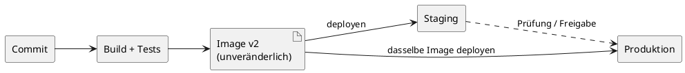
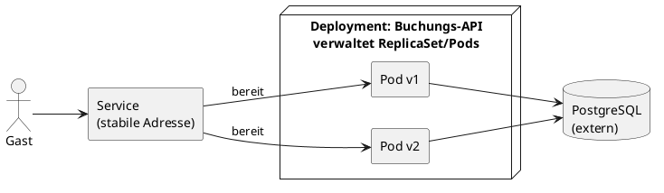

---
title: "Skalierbare Systeme - Betrieb, Observability & Deployment"
topic: "scalable_systems_1_6"
author: "Lukas Panni"
theme: "metropolis"
fonttheme: "structurebold"
fontsize: 12pt
urlcolor: BrickRed
linkcolor: BrickRed
aspectratio: 169
lang: de-DE
numbersections: true
plantuml-format: svg
toc: true
section-titles: true
...

# Einstieg und Rückblick

## Heute: Eine Änderung geht live

- Cal.diy-Lehrmodell: Buchung, PostgreSQL, Outbox und Kalender-Worker
- Neu: interne Notiz zu einer Buchung
- Lokal funktioniert alles – was passiert beim Ausrollen?
- Weg: **prüfen → ausliefern → beobachten → eingreifen → lernen**

## Was wir schon wissen (Vorlesungen 2 und 4)

- **V2:** Die Datenbank verhindert Doppelbuchungen; Mandantengrenzen gelten auch für neue Felder.
- **V4:** Buchung + Outbox atomar; Kalender-Sync läuft nachgelagert.
- **V4:** SLI = Anteil gültiger Buchungsabsichten mit Bestätigung innerhalb von 2 s.
- **V4:** SLO = mindestens 99,9 % in rollierenden 28 Tagen.

## Lernziele

- Eine Änderung als geprüftes Artefakt bis zur Produktion verfolgen
- Rollout und Datenbankschema kompatibel gestalten
- Nutzerwirkung mit Metriken, Logs und Traces untersuchen
- Auf einen Incident reagieren und eine Verbesserung ableiten
- Zwischen Sicherheit, Tempo und Betriebskosten abwägen
- Laufzeitmodelle, GitOps und DORA-Kennzahlen einordnen

# Eine Änderung sicher ausliefern

## Problem: „Läuft bei mir“ genügt nicht

- Neue Notizspalte; mehrere App-Instanzen laufen parallel
- Die alte Version kennt die Spalte noch nicht
- Ein fehlerhafter Build könnte alle Buchungen betreffen
- Ziel: **reproduzierbar prüfen, genau das Geprüfte ausliefern**

## CI, Delivery, Deployment

- **Continuous Integration:** häufig integrieren, automatisch bauen und testen
- **Continuous Delivery:** geprüfte Version jederzeit auslieferbar halten
- **Continuous Deployment:** jede erfolgreiche Änderung automatisch produktiv setzen
- Automatik spart Wartezeit; riskante Freigaben dürfen bewusst manuell bleiben

## Delivery oder Deployment?

```text
Commit -> CI (Build + Tests) -> geprüftes Artefakt
                                     |
                  +------------------+-----------------+
                  |                                    |
         Continuous Delivery                Continuous Deployment
          manuelle Freigabe                   automatisch live
                  |                                    |
                  +------------> Produktion <----------+
```

- **Gemeinsam:** automatisch prüfen und dasselbe Artefakt ausliefern.
- **Unterschied:** Bei Delivery kann eine manuelle Produktionsfreigabe vorgesehen sein; bei Deployment geschieht dies automatisch.
- Cal.diy: v2 zuerst prüfen, dann den Canary bewusst freigeben.

## Ein Artefakt, mehrere Umgebungen



- Tests: fachliche Buchungsregel, Datenbankintegration, wichtiger Nutzerfluss
- Bei Fehler abbrechen; Version und Testergebnis nachvollziehbar halten
- Secrets erst zur Laufzeit bereitstellen – nie ins Image

## Was testet die Pipeline – und was nicht?

| Prüfung | Fängt ab | Fängt nicht sicher ab |
| :-- | :-- | :-- |
| Unit-Test | Fehler in Notizlogik | echte DB-Konflikte |
| Integrationstest | Migration + Buchungsregel | Produktionslast |
| Staging-Flow | Notiz speichern und lesen | reale Traffic-Verteilung |
| Canary | Probleme unter echter Last | seltene Fehler bei 100 % |

**Best Practice:** schnelle Checks zuerst, kritische Nutzerpfade vor dem Rollout.

## Canary: schrittweises Ausrollen

- **Definition:** Bei einem *Canary Deployment* läuft v2 zunächst nur für einen kleinen Anteil des produktiven Traffics; v1 bleibt verfügbar.
- **Idee:** Risiko begrenzen, v1 und v2 unter vergleichbarer realer Last messen und dann schrittweise erweitern.

```text
                  +--> v1 (z. B. 90 %)
Nutzer -> Router -|
                  +--> v2 (z. B. 10 %) -> messen -> Go / Stop
```

- **Wichtig:** Das ist eine Rollout-Strategie, kein eigener Testtyp

## DevOps: mehr als CI/CD

- **Definition:** DevOps verbindet Entwicklung (*Dev*) und IT-Betrieb (*Ops*) durch Zusammenarbeit, gemeinsame Verantwortung und schnelle Feedbackschleifen.
- **Ziel:** Änderungen zuverlässig und häufig zu Usern bringen – statt sie am Übergang zwischen Teams zu übergeben.
- **Praktiken:** kleine Änderungen, CI/CD, automatisierte Tests, Observability und gemeinsame Incident-Bearbeitung.
- **Kultur:** Teams optimieren den gesamten Nutzerfluss; SLOs und Betriebserfahrungen beeinflussen die Entwicklung.
- **Nutzen:** kürzere Feedbackzeit, besser reproduzierbare Releases und schnellere Wiederherstellung – nicht einfach „ein neues Tool“.

## DevOps: Verantwortung und Tradeoffs

- **Build it, run it:** Das Team kennt Rollout, Alerts, Runbook und Rückweg der eigenen Änderung.
- **Weniger Übergaben:** Wer entwickelt, sieht Produktionsprobleme früh und verbessert Tests und Architektur.
- **Kein Organisationsdogma:** On-Call und Plattformbetrieb können geteilt oder spezialisiert sein; Ownership muss klar sein.
- **Tradeoff:** Automatisierung, Telemetrie und Rufbereitschaft verursachen Aufwand – sie sollen messbar Risiko und Wartezeit senken.

## Wo gehört die Prüfung hin?

- Alte und neue App greifen gleichzeitig auf Buchungen zu.
- Ein doppelter Slot darf niemals bestätigt werden.
- Eine neue Notiz darf nicht bei fremden Mandanten auftauchen.
- Welche Prüfungen vor Produktion? Was erst im Canary sichtbar?

## Migration: alte und neue Version gleichzeitig

- `internal_note` zunächst **nullable** ergänzen: alte App bleibt lauffähig
- v2 deployen; Notiz nur für berechtigte Nutzer freigeben
- Für die optionale Notiz: kein Backfill und kein Entfernen alter Felder nötig
- Code-Rollback auf v1 bleibt möglich; die neue Spalte bleibt bestehen

## GitOps: gewünschter Zustand in Git

- **Prinzip:** Git enthält deklarativ den *gewünschten* Zustand, z. B. welche Image-Version laufen soll.

```text
CI baut Image -> Registry (sha256:...) -> Git-PR: neuer Digest
                                      |
                                 Review / Merge
                                      |
                          GitOps-Controller -> Cluster
                                      ^             |
                                      +-- Abgleich -+
```

- Controller (z. B. Argo CD) vergleicht gewünschten mit tatsächlichem Zustand und synchronisiert nach Freigabe.
- **Vorteile:** Review, Änderungshistorie und nachvollziehbare Rückkehr zu einer Konfiguration; Drift wird sichtbar.
- **Grenzen:** zusätzliche Infrastruktur und Rechte; Datenbankmigrationen brauchen weiterhin eigene Koordination.

## GitOps: das Deployment von Cal.diy in der Praxis

1. CI baut und testet `cal-diy`; das Image landet unveränderlich in einer Registry (`sha256`-Digest).
2. Ein Pull Request ändert im **Konfigurations-Repository** die referenzierte Image-Version und ggf. Ressourcenlimits.
3. Nach Review/Merge gleicht z. B. **Argo CD** den Git-Zustand mit dem Cluster ab; bei manuellem Sync folgt eine Freigabe.
4. Status und Abweichungen sind sichtbar; Rollback = vorherigen Konfigurationsstand wiederherstellen **und** Datenkompatibilität prüfen.

## Deployment != Release

- **Deployment:** v2 ist technisch in Produktion; **Release:** Nutzende können die Notiz tatsächlich verwenden.
- **Feature Flag:** `internal_note_enabled` ist zunächst nur für das interne Team aktiv.
- **Vorteil:** Funktion kontrolliert freigeben oder deaktivieren, ohne das Image erneut auszuliefern.
- **Grenze:** Bereits geschriebene Daten bleiben; ein Flag ersetzt weder Autorisierung noch ein Code-Rollback.
- **Betrieb:** Flags mit Eigentümer, Zweck, Metrik und geplantem Löschtermin verwalten.

## Feature Flags: wie wird die Funktion eingeschaltet?

```text
Image v2 ist überall installiert
            |
Flag-Evaluierung (z. B. Team / Mandant / Prozentanteil)
            |
      AN: Notiz anzeigen    AUS: Notiz verstecken
```

- Der Dienst liest die Flag-Konfiguration zur Laufzeit (lokale Konfiguration oder Feature-Flag-Service).
- Zielgruppensteuerung: interne Mitarbeitende → Pilotmandanten → alle berechtigten Nutzenden.
- **Sicherheitsregel:** Die API prüft Berechtigungen **immer** selbst – auch bei aktiviertem Flag.
- **Aufräumen:** Nach stabilem Release Flag und ungenutzten Codepfad entfernen.

# Risiko beim Rollout begrenzen

## Problem: v2 ist getestet – aber wie viel Risiko?

- Produktivlast und Staging unterscheiden sich
- Rollout betrifft gleichzeitig API, Datenbank und Worker
- Ein schneller Rückweg zählt mehr als ein schönes Dashboard
- Vorab festlegen: **Was stoppt den Rollout? Wer entscheidet?**

## Strategien im Vergleich

| Strategie | Vorteil | Grenze |
| :-- | :-- | :-- |
| Recreate | einfach | Unterbrechung beim Wechsel |
| Rolling Update | wenig Zusatzkapazität | v1/v2 überlappen; nicht automatisch exakter Traffic-Anteil |
| Blue/Green | schneller Traffic-Wechsel | parallele Umgebung; Datenbank oft gemeinsam |
| Canary | kleiner Auswirkungsbereich | gezieltes Routing und Messung nach Version nötig |

**Cal.diy:** Canary, wenn Versions-Traffic und Messung verfügbar sind; andernfalls Rolling mit sicherem Stopp. Das geht mit Load Balancer, PaaS, Service-Mesh oder Orchestrator.

## Canary: erst messen, dann erweitern

```text
10 % v2 -> messen -> Go/Stop -> 50 % -> erneut prüfen -> 100 %
                         |
                      Stop: zurück zu v1
```

- Wenige Nutzer zuerst: kleiner Auswirkungsbereich, aber wenig Messdaten
- v1 und v2 getrennt und bei vergleichbarem Traffic beobachten
- Nicht „grün“, nur weil die Gesamtfehlerquote stabil bleibt

## Canary: Versionen getrennt betrachten

{height=82%}

## Go/Stop-Gate für Cal.diy

- **p95:** Latenzwert, den mindestens 95 % der beobachteten Requests nicht überschreiten.
- **Stop:** p95 von v2 > 1,5 × p95 von v1 oder DB-Pool-Wartezeit p95 > 200 ms.
- **Go:** Grenzen eingehalten **und** Buchungs-SLI stabil; sonst pausieren oder zurückrollen.
- **Verantwortung:** Release-Team entscheidet; zu wenig Traffic bedeutet **keinen** Beweis für Sicherheit.

## Health Checks sind nicht das SLO

- **Liveness:** Hängt der Prozess? Nur bei echtem Hänger neu starten.
- **Readiness:** Kann die Instanz aktuell Anfragen annehmen? Nur bereite Instanzen erhalten Traffic.
- Ein `HTTP 200` vom Health-Endpunkt belegt **nicht**, dass Buchungen erfolgreich sind (SLO).
- **Bezug zu Failover:** Fallen Instanzen aus, übernimmt gesunde Kapazität – sofern Routing und Ressourcen reichen.
- **Achtung:** Prüft Readiness zu streng eine gemeinsam ausgefallene Datenbank, kann sie *alle* API-Instanzen gleichzeitig aus dem Routing nehmen.

## Rollout-Entscheidung: Go, Pause oder Stop?

- v2 erhält 10 % Traffic; ihre p95-Latenz ist doppelt so hoch wie bei v1.
- Die Gesamtfehlerquote bleibt fast unverändert; v2 belegt doppelt so viele DB-Verbindungen.
- **Entscheidung?** Das vorab definierte Gate spricht für **Stop / Rückkehr zu v1**, nicht für 50 %.
- **Diskussion:** Welche zwei zusätzlichen Signale helfen? Z. B. Buchungs-SLI **je Version** und p95 **der DB-Pool-Wartezeit**.

## Rückweg: Code und Daten sind verschieden

- Bei Schaden: Canary stoppen, v2-Traffic zurück auf v1
- Nullable Spalte bleibt vorerst bestehen; nicht blind „zurückmigrieren“
- Falls v2 schon neue Daten geschrieben hat: Lesbarkeit mit v1 prüfen
- Roll-forward statt Rollback, wenn neue Daten nicht rückwärtskompatibel sind

# Laufzeit und Orchestrierung

## Welche Laufzeit für Cal.diy?

| Modell | Vorteil | Nachteil |
| :-- | :-- | :-- |
| Bare Metal | maximale Kontrolle | Hardware selbst betreiben |
| Virtuelle Maschine | eigener OS-Stack, gute Isolation | Gast-OS patchen und verwalten |
| Container | paketierte Laufzeit, gut ersetzbar | Host / Plattform weiter nötig |
| FaaS (Serverless) | ereignisgesteuert, Anbieter skaliert Ausführung | Laufzeit-, Parallelitäts- und Plattformgrenzen |

- **Wichtig:** Container sind ein *Paketierungs-/Prozessmodell*, FaaS ein *Betriebsmodell* – kein striktes Entweder-oder.
- Wer Container auf einer Managed-Plattform ausführt, delegiert ebenfalls viel Betrieb.

## Container: vom Image zum laufenden Prozess

```text
Quellcode + Abhängigkeiten -> CI -> Container-Image -> Registry
                                              |
                                      Host / Plattform startet
                                              |
                                    laufender Container-Prozess
```

- **Image:** unveränderliches Paket mit Anwendung, Runtime und Abhängigkeiten; **Container:** laufende, isolierte Instanz davon.
- Container teilen typischerweise den Kernel des Hosts; eine VM bringt einen eigenen Gast-Kernel mit.
- Neustart/Ersetzung müssen möglich sein: Zustand in PostgreSQL oder persistenten Diensten, nicht im Container-Dateisystem.
- **Cal.diy:** identisches API-Image in Staging und Produktion; unterschiedliche Secrets und Konfiguration zur Laufzeit.

## Container und FaaS im Vergleich

| Frage | Container-Dienst | FaaS |
| :-- | :-- | :-- |
| Start | Plattform startet dauerhaft laufende Prozesse | Ereignis löst Funktionsaufruf aus |
| Skalierung | Replikate / CPU / Requests konfigurieren | parallele Ausführungen innerhalb von Limits |
| Laufzeit | HTTP-Server oder langlebiger Worker | Handler, oft kurzlebige Aufgaben |
| Kosten | oft reservierte/laufende Kapazität | häufig Aufrufe und Ausführungsressourcen |
| Typisches Risiko | Leerlauf, Rollout-/Hostbetrieb | Kaltstarts, Quotas, Verbindungsstürme |

**Beides** kann auf gemanagter Infrastruktur laufen; die tatsächliche Kosten- und Latenzkurve messen.

## Serverless: Wer betreibt die Server?

- **Serverless ≠ ohne Server:** Der Anbieter verwaltet Server und Ausführungsumgebungen; das Team liefert Code, Rechte und Konfiguration.
- **FaaS:** Event oder HTTP-Request startet einen Handler; die Plattform verwaltet Instanzen und Parallelität.
- Neue Ausführungsumgebungen brauchen ggf. Initialisierung (**Kaltstart**); warme Umgebungen können wiederverwendet werden.
- **Vorteil:** seltene / schwankende Arbeit benötigt keine permanent reservierten Worker.
- **Grenzen:** Timeouts, CPU/Speicher, Parallelität, Netzwerk- und Plattform-APIs unterscheiden sich je Anbieter.

## FaaS-Runtime: Was passiert bei einem Event?

```text
Event / HTTP-Aufruf
      -> Plattform weist Ausführungsumgebung zu
      -> ggf. Init: Runtime + Abhängigkeiten + Verbindungen
      -> Handler verarbeitet Auftrag
      -> Antwort / Ack; Umgebung ggf. wiederverwenden
```

- **Kaltstart:** Initialisierung bei neuer Umgebung; **Warmstart:** vorhandene Umgebung wird erneut genutzt.
- Keine dauerhafte Prozesslaufzeit voraussetzen; externe Seiteneffekte müssen Wiederholungen tolerieren.
- Beispiel Cal.diy: Outbox-Event → Kalender-Handler; Queue puffert Spitzen, Idempotenz verhindert Doppelarbeit.

## FaaS ist nicht gleich FaaS: Lambda vs. Workers

| | AWS Lambda | Cloudflare Workers |
| :-- | :-- | :-- |
| Ausführung | isolierte Execution Environment + Runtime; Init/Invoke | sehr leichtgewichtige V8-Isolates |
| Sprachen/APIs | mehrere Runtimes, Container-/ZIP-Pakete | JS/TS, Web APIs und WebAssembly-Ökosystem |
| Start/Lebensdauer | Kaltstarts möglich; Warm-Reuse, optionale Vorwärmung | Isolates starten meist sehr schnell; ebenfalls Limits |
| Typische Nähe | Cloud-Events, Queues, Backend-Integrationen | Edge-/HTTP-Logik, verteilte Requests |

- Kein „besser“ ohne Lastprofil: CPU, Laufzeit, Speicher, Datenbankzugriff, Region und Preis vergleichen.
- **Cal.diy:** Kalender-Sync als Event-Handler prüfen; direkte PostgreSQL-Verbindungen am Edge besonders hinterfragen.

## Cal.diy: Wo passt eine Function?

- Kalender-Sync nach dem Outbox-Commit: Worker kann Events an FaaS übergeben
- FaaS-Verarbeitung bleibt idempotent; Wiederholungen und Duplikate erwarten (V4)
- Buchungs-API braucht niedrige p95-Latenz: Kaltstarts vorher messen
- Viele parallele Functions können PostgreSQL-Verbindungen erschöpfen
- Grenze setzen, Pooling prüfen; kein Serverless nur um „modern“ zu sein

## Serverless: Skalierung gegen die Datenbank

- Beispiel: 40 Events/s × 2 s Laufzeit: etwa 80 gleichzeitige Functions
- Je zwei DB-Verbindungen → bis zu 160; DB-Limit: 100
- Function-Skalierung drosseln oder Verbindungspool/Queue nutzen
- Warteschlange wächst dann: Alter der Aufträge beobachten (V4)
- Tradeoff: Kosten für Leerlauf sparen, aber Sättigung verlagern

## Cal.diy: Wenn Functions schneller skalieren als die Datenbank

{height=82%}

## Wann lohnt sich FaaS?

| Lastprofil | Tendenz | Grund |
| :-- | :-- | :-- |
| Seltene Kalender-Events | FaaS | keine dauerhaft laufende Worker-Instanz |
| Kurze, starke Spitzen | FaaS prüfen | skaliert schnell; Limits und DB schützen |
| Dauerhaft hohe Last | Container prüfen | nutzungsabhängige Kosten summieren sich |
| Strenge API-Latenz | messen | Kaltstart kann p95 verschlechtern |

## Die Rechnung endet nicht beim Aufrufpreis

```text
FaaS: Aufrufe + Laufzeit × Speicher + Netz/Logs + ggf. Warmhaltung
Container: laufende Kapazität + Netz/Logs + Betriebsaufwand
```

- Bei Leerlauf spart FaaS oft Kapazitätskosten; bei Dauerlast vergleichen
- Warmgehaltene Functions senken Kaltstarts, kosten aber auch ohne Aufrufe
- Kosten **und** p95, DB-Verbindungen, Limits unter realer Last messen
- Cal.diy: Worker eher geeignet als die synchrone Buchungs-API

## Serverless: Das Lastprofil entscheidet

{height=82%}

## Warum Container orchestrieren?

- Eine App-Instanz fällt aus: Wer startet sie neu?
- Lastspitze: Wer verteilt Traffic und startet weitere Instanzen?
- v1 und v2 gleichzeitig: Wer steuert Update und Rückweg?
- Orchestrator löst diese Betriebsfragen, nicht die DB-Konsistenz

## Kubernetes

- **Cluster:** mehrere Rechner (Nodes) plus *Control Plane*, die den gewünschten Zustand verwaltet.
- **Pod:** kleinste planbare Einheit; enthält einen oder mehrere eng gekoppelte Container.
- **Deployment:** beschreibt z. B. „vier API-Pods mit Image v2“; Controller ersetzt ausgefallene Pods.
- **Service:** stabile virtuelle Adresse und Weiterleitung zu passenden, bereiten Pods.
- **Control Loop:** Ist-Zustand wird laufend mit dem Soll-Zustand abgeglichen.

## Kubernetes: die Bausteine



- Ein **Pod** beherbergt den laufenden API-Container; der **Service** verteilt auf bereite Pods.
- Beim Rolling Update kann das Deployment vorübergehend v1 und v2 gleichzeitig betreiben.
- Für *gewichtete* Canaries zusätzlich Routing-Unterstützung (Gateway, Mesh, PaaS etc.) nutzen.

## Kubernetes: Möglichkeiten und Grenzen

- Deployment: Rollouts und Selbstheilung; HPA: Pods nach Last skalieren
- Job/CronJob: einmalige oder geplante Aufgaben, z. B. Datenpflege
- ConfigMaps/Secrets: Konfiguration trennen; Zugriff absichern
- Namespace/Quota: Teams und Ressourcen begrenzen, keine harte Sicherheitsgrenze
- Mehr Pods können den DB-Pool überlasten; Datenbank separat betreiben
- Alternative: Managed Container/PaaS bei weniger Betriebsaufwand

## Kubernetes: gewünschter Zustand und Rolling Update

```text
Deployment: 4 Pods mit Image v1 -> Image v2 eintragen
Controller: neuen Pod starten -> Readiness prüfen -> alten entfernen
```

- `maxSurge: 1`: höchstens ein zusätzlicher Pod beim Update.
- `maxUnavailable: 0`: vier verfügbare Pods sollen erhalten bleiben, wenn Kapazität reicht.
- Hängt v2 in Readiness, stockt das Update; Fehler des Readiness-Signals gesondert prüfen.
- Ein Kubernetes-Service verteilt auf bereite Pods, **nicht automatisch exakt 10 %** auf v2.
- **Kein Kubernetes-Monopol:** Rolling Updates funktionieren auch mit Load Balancern, VM-Gruppen und Managed-Container-Diensten.

## Kubernetes: Rolling Update im Ablauf

{height=82%}

## Kubernetes: Skalierung hat eine Grenze

- HPA passt die Pod-Zahl anhand von CPU oder anderen Metriken an
- Beispiel: 2 → 6 API-Pods mit je 20 DB-Verbindungen = bis zu 120
- Hat die Datenbank nur 100 Plätze, steigt die Wartezeit trotz mehr Pods
- `maxReplicas` und Poolgrößen begrenzen; DB-Signale mitbeobachten
- HPA ersetzt weder Kapazitätsplanung noch Canary-Go/Stop-Gate

# Auswirkungen sichtbar machen

## Problem: „Langsam“ ist noch keine Diagnose

- Nutzende melden träge Buchungen nach v2
- Datenbank erreichbar; CPU der API unauffällig
- Welche Nutzer? Welche Version? Wo wartet der Request?
- **Monitoring** meldet bekannte Symptome; **Observability** hilft bei der Ursachenfrage

## Drei Signale – drei Fragen

| Signal | Frage zum Buchungsrequest | Grenze |
| :-- | :-- | :-- |
| Metrik | Wie viele sind langsam? | kein einzelner Ablauf |
| Log | Was geschah bei Buchung X? | kein Gesamtbild |
| Trace | Wo wartete dieser Request? | nur erfasste Requests |

**Best Practice:** Version und Trace-ID korrelieren; Signale nicht gegeneinander ausspielen.

## Dieselbe Störung aus drei Perspektiven

```text
METRIK   v2: p95 Buchungsbestätigung = 1,4 s (v1: 0,5 s)
LOG      event=booking.slow trace_id=abc123 db_wait_ms=870
TRACE    POST /bookings -> DB-Pool warten (870 ms) -> SQL
```

- **Metrik:** Welche Nutzerwirkung und wie oft? (Zeitreihe, Version, Zeitraum)
- **Log:** Welches konkrete Ereignis und welche Attribute? (kein Personeninhalt)
- **Trace:** Welcher Schritt verursachte die Wartezeit? (zusammenhängende Spans)
- **Zusammenspiel:** v2-Dashboard → auffällige Trace-ID → DB-Pool-Log → mögliche Ursache.

## Metriken: Nutzerwirkung zuerst

- **Rate:** gültige Buchungsabsichten pro Minute, getrennt nach Version.
- **Errors:** nicht bestätigte bzw. zu spät bestätigte Absichten gemäß SLI aus V4.
- **Duration:** Dauer von Anfrage bis Bestätigung; p95 und Verteilung statt nur Mittelwert.
- **Ursachensignale:** DB-Pool-Wartezeit, aktive Verbindungen und Alter offener Outbox-Aufträge.
- **Messregel:** nur passende gültige Absichten zählen; Labels mit hoher Kardinalität (z. B. einzelne Buchungs-IDs) vermeiden.

## p95 statt nur Durchschnitt

```text
90 Buchungen: 0,1 s
10 Buchungen: 5,0 s

Mittelwert: 0,59 s
p95:        5,0 s
```

- **p95** heißt: mindestens 95 % der Messungen sind höchstens so langsam wie dieser Wert.
- Obwohl der Durchschnitt gut aussieht, sind hier 10 % der Nutzenden sehr langsam.
- Immer mit Zeitraum, Stichprobengröße, Buchungs-SLI und Version betrachten.

## Logs: Kontext, nicht Datenmüll

```text
level=warn event=booking.slow service=booking-api
version=v2 trace_id=abc123 db_wait_ms=870
```

- **Strukturierte Felder** statt schwer filterbarem Fließtext; Version und Trace-ID einheitlich setzen.
- Logs beschreiben Ereignisse; eine einzelne Zeile beweist noch keinen Systemtrend.
- Keine Secrets oder unnötigen Personendaten in Logs; Zugriff und Aufbewahrung begrenzen.
- Trace-Kontext bei asynchronem Übergang zur Outbox/Worker-Kette explizit weitergeben.

## Trace: Wo geht die Zeit hin?

```text
POST /bookings                    1.400 ms (gesamt)
|-- authorize                        12 ms
|-- wait for DB connection          870 ms
`-- DB: Buchung + Outbox           110 ms
```

- **Span:** ein Arbeitsschritt mit Start/Ende und Attributen; **Trace:** zusammengehörige Spans eines Ablaufs.
- **Interpretation:** Der DB-Pool ist auffällig; die genannten Span-Zeiten müssen nicht zur Gesamtdauer aufsummieren.
- Sampling senkt Telemetriekosten, kann aber seltene Fehler übersehen.

## Trace: Die Wartezeit wird sichtbar

{height=82%}

## OpenTelemetry (OTel): Signale transportieren

- **OpenTelemetry (OTel):** offener, herstellerneutraler Standard und Werkzeugsatz für Instrumentierung, Sammlung und Export von Telemetrie.
- **SDK / automatische Instrumentierung:** API- und DB-Spans, Metriken; Logs können korreliert werden.
- **Trace Context:** verbindet asynchrone Teile nur, wenn der Kontext über Outbox und Worker weitergegeben wird.
- **Collector:** empfängt, verarbeitet und exportiert Daten (häufig über OTLP).
- **Abgrenzung:** OTel ist **kein** Dashboard, keine Alert-Regel und kein Storage-Backend.
- Sampling, Kardinalität, Datenminimierung und Zugriffsrechte bewusst planen.

## Möglicher Betriebsstack für Cal.diy

**Ein mögliches Beispiel** (LGTM = Loki, Grafana, Tempo, Mimir; hier vereinfachte Prometheus-Variante):

```text
Cal.diy -- OTel / OTLP --> Collector
                               |-- Metriken -> Prometheus --+
                               |-- Traces --> Tempo -------+--> Grafana
                               `-- Logs ----> Loki --------+
```

- **OTel** standardisiert Instrumentierung und Export; **LGTM / Prometheus** sind austauschbare Werkzeuge für Speicherung und Visualisierung.
- Alternativen: Jaeger, andere Metrik-/Log-Backends oder Managed-Plattformen; Kompatibilität und Exportwege prüfen.
- Selbstbetrieb: mehr Kontrolle und Aufwand; Managed: weniger Betrieb, dafür Gebühren und Datenresidenz klären.

## OTel und Backend: was bleibt austauschbar?

```text
App-Instrumentierung (OTel SDK)
            | OTLP
            v
      OTel Collector -----> Storage A -----> Dashboard A
            |
            +-------------> Storage B -----> Dashboard B
```

- **Stabiler Teil:** Semantik von Spans/Metriken/Logs und Export-Schnittstellen.
- **Austauschbar:** Collector-Konfiguration, Speichersystem, Dashboards, Alerting.
- **Nicht automatisch portabel:** alle Abfragen, Dashboards, Kosten und Backendspezifika.

**Merksatz:** *OpenTelemetry ist die offene Telemetrie-Schnittstelle; LGTM ist nur eine mögliche Implementierung dahinter.*

## Betriebs- und Nutzerperspektive: zwei Wege

{height=82%}

## Vom SLI zum handlungsfähigen Alert

- V4-SLO: 99,9 % gute Buchungsabsichten in 28 Tagen
- Bei 50.000 Absichten: höchstens 50 schlecht; 40 verbraucht → 10 übrig
- Alert bei schnellem Budgetverbrauch oder akutem Buchungsausfall
- Ziel: Nutzerwirkung + zuständiges Team + sicherer erster Schritt

## Beispiel: Observability-Konzept für Cal.diy

- **Frage:** Buchen Gäste seit v2 seltener erfolgreich?
  - Welche Signale sind dafür relevant? Welche Daten müssen wir erfassen?
- **Dashboard:** SLI und p95 nach Version; DB-Pool-Wartezeit
- **Drill-down:** Trace-ID → langsamer DB-Span → Log zum Pool
- **Aktion:** Canary pausieren; Pool-Limit und Worker-Verbindungen prüfen

# Incident und Lernschleife

## v2 verschlechtert Buchungen: jetzt handeln

```text
Erkennen → Koordinieren → Eingrenzen → Wiederherstellen → Lernen
```

- Eine Person koordiniert, eine untersucht; Wirkung und Zeiten notieren
- Canary pausieren, v2-Traffic zurücknehmen, Buchungs-SLI beobachten
- Stakeholder über Auswirkung und nächsten Stand informieren
- Ursachenanalyse nach der Stabilisierung vertiefen (Bezug Vorlesung 4)

## Runbook: nicht erst im Incident schreiben

- Symptom: SLI sinkt nach Rollout; v2-Pool-Wartezeit steigt
- Erste Checks: Version, Traffic-Anteil, Pool, DB-Fehler
- Sofortmaßnahme: Traffic zu v1, wenn Daten kompatibel bleiben
- Eskalation: API- und Datenbankverantwortliche; Link zum Dashboard

## Postmortem: Ursache statt Schuld

- Siehe Vorlesung 4
- **Befund:** v2-API öffnet zu viele Verbindungen; v1 bleibt gesund
- **Bedingung:** Testlast und Pool-Konfiguration bildeten Produktion nicht ab
- **Maßnahme:** Pool-Limit + Lasttest + Canary-Gate für Pool-Wartezeit
- **Nachweis:** Rollout erneut mit begrenztem Canary testen

## Wer trägt den Betrieb?

- DevOps: Entwicklung und Betrieb teilen Verantwortung für den Nutzerfluss
- SRE: SLOs, Fehlerbudget und weniger manuelle Routine
- On-Call braucht klare Alerts, Zugriff und getestete Runbooks
- Mehr Automatisierung spart Arbeit – falsch konfigurierte Gates blockieren Releases

## DORA: Wie gut liefern wir Änderungen aus?

- **Change Lead Time:** Commit bis produktiv; lange Wartezeit finden
- **Deployment Frequency:** wie oft geht eine Version produktiv?
- **Failed Deployment Recovery Time:** wie schnell nach einem fehlgeschlagenen Deployment wiederhergestellt?
- Cal.diy: Warten v2-Änderungen auf Freigabe oder auf Tests?

## DORA: Tempo ohne Stabilität ist kein Erfolg

- **Change Fail Rate:** Anteil Deployments mit nötigem Soforteingriff
- **Deployment Rework Rate:** Anteil ungeplanter Folge-Deployments nach Incident
- Beispiel: 20 Deployments, 2 Soforteingriffe → 10 % Change Fail Rate
- Alle fünf gemeinsam pro Dienst über Zeit betrachten – kein Personen-Ranking

## DORA: welche Praktiken verbessern die Kennzahlen?

| Praxis | Erwarteter Beitrag |
| :-- | :-- |
| Kleine Änderungen, kurzlebige Branches | kürzere Lead Time, einfacher Rückweg |
| Schnelle, verlässliche CI-Tests | weniger Fehler, weniger Wartezeit |
| Automatisierte reproduzierbare Deployments | höhere Frequenz, geringere manuelle Fehlerquote |
| Kompatible DB-Migrationen + Canary / Flags | geringere Change Fail Rate und Auswirkung |
| SLOs, gutes Alerting, Runbooks | schnellere Recovery nach Fehlschlägen |

**Wichtig:** DORA ist ein Diagnoseinstrument; keine Kennzahl isoliert maximieren.

## DORA: aus einer Messung eine Verbesserung ableiten

- **Beobachtung:** Cal.diy liefert selten aus, weil jede Freigabe lange manuelle Tests braucht.
- **Hypothese:** ein stabiler automatisierter Staging-Flow verkürzt die Change Lead Time.
- **Änderung:** kritische Buchungstests automatisieren; kleine PRs und Canary-Gate beibehalten.
- **Gegenprüfung:** Lead Time und Deployment Frequency **sowie** Change Fail Rate / Rework über mehrere Wochen verfolgen.
- **Keine Rangliste:** Team- und Dienstkontext erklären Unterschiede; nicht individuelle Leistung bewerten.

# Zusammenfassung

## Der Kreis schließt sich

```text
Änderung -> Pipeline -> Rollout -> Nutzer-Signale
    ^                              |
    +----- Postmortem <- Incident --+
```

- Getestetes Artefakt, kompatible Daten, kleiner Auswirkungsbereich
- Erst Nutzerwirkung messen, dann mit Logs und Traces erklären
- Abstraktion spart Eigenbetrieb, ersetzt weder SLO noch Datenregeln
- Tradeoff: Tempo, Kontrolle, Kosten und Zuverlässigkeit

# Literatur und Quellen

## Zum Nachlesen

- Beyer et al.: [Site Reliability Engineering](https://sre.google/sre-book/table-of-contents/) – Release Engineering, Monitoring und Incidents.
- Google: [SRE Workbook](https://sre.google/workbook/table-of-contents/) – SLOs, Alerts und Fehlerbudgets.
- Humble, Farley: *Continuous Delivery* – Deployment-Pipelines und Migrationen.
- Majors et al.: *Observability Engineering* – Metriken, Logs und Traces.
- [OpenTelemetry – Was es ist (und nicht ist)](https://opentelemetry.io/docs/what-is-opentelemetry/) – offene Instrumentierung.
- [DORA – Delivery Metrics](https://dora.dev/guides/dora-metrics/) und [Continuous Delivery Capabilities](https://dora.dev/capabilities/continuous-delivery/) – Kennzahlen und Praktiken.

## Dokumentation zu Deployment und Laufzeit

- [Kubernetes: Deployments](https://kubernetes.io/docs/concepts/workloads/controllers/deployment/) und [Rolling Updates](https://kubernetes.io/docs/tasks/run-application/update-deployment-rolling/) – Orchestrierung.
- [Argo CD: Core Concepts](https://argo-cd.readthedocs.io/en/stable/core_concepts/) – GitOps/Abgleich.
- [Docker: Was ist ein Container?](https://docs.docker.com/get-started/docker-concepts/the-basics/what-is-a-container/) – Container und VM.
- [AWS Lambda: Runtime Lifecycle](https://docs.aws.amazon.com/lambda/latest/dg/lambda-runtime-environment.html) und [Cloudflare Workers: How Workers works](https://developers.cloudflare.com/workers/reference/how-workers-works/) – FaaS-Modelle.
- [OpenFeature: Feature Flags](https://openfeature.dev/docs/reference/intro/) und [Google Cloud: Canary Deployment](https://docs.cloud.google.com/deploy/docs/deployment-strategies/canary) – sichere Freigaben.
