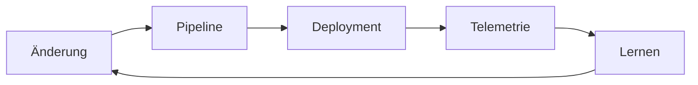

# Einstieg und Orientierung

## Skalierbare Systeme – Vorlesung 6

- Betrieb
- Deployment
- Observability und Monitoring
- Entwicklungsprozesse
- Durchgängiges Beispiel: Cal.com Teaching Model

[DARSTELLUNG: Kreislauf Code → Deployment → Betrieb → Erkenntnis → Code]

## Lernziele

Nach der Vorlesung können die Studierenden …

- Continuous Integration und Continuous Delivery unterscheiden
- eine einfache Deployment Pipeline erklären
- grundlegende Rollout-Strategien vergleichen
- Logs, Metriken und Traces unterscheiden
- sinnvolle Alerts von reinen Dashboards abgrenzen
- Incident Response und Postmortem einordnen

## Rückblick auf die bisherigen Vorlesungen

Vorlesung 2:

- mandantengebundene Daten
- Transaktionen und Security by Design

Vorlesung 4:

- SLOs und Error Budgets
- Timeout, Retry und Idempotenz
- Redundanz und Recovery

Heute:

- Änderungen sicher in dieses System bringen
- Verhalten in Produktion verstehen

## Leitfrage

Eine Änderung funktioniert lokal.

- Wie wird daraus ein überprüfbares Artefakt?
- Wie gelangt es sicher in Produktion?
- Wie erkennen wir negative Auswirkungen?
- Wer reagiert im Störungsfall?
- Wie fließt das Gelernte zurück?

## Vier Einheiten

1. Von der Änderung zum Artefakt
2. Sicher deployen und releasen
3. Monitoring und Observability
4. Betrieb, Incidents und Lernen

- Planungsumfang: etwa 38 Minuten je Einheit
- Puffer: etwa 7 Minuten je Einheit
- Eine vertiefende Arbeitsphase in der gesamten Vorlesung

# Einheit 1 – Von der Änderung zum Artefakt

## Definition: Continuous Integration

- Änderungen häufig zusammenführen
- automatisiert bauen und testen
- Integrationsprobleme früh erkennen
- Hauptzweig bleibt möglichst funktionsfähig

Kurzform:

- CI reduziert das Risiko später Integration

Nicht nur:

- ein CI-Server
- ein grünes Symbol in GitHub

## Definition: Continuous Delivery

- Software bleibt jederzeit auslieferbar
- Build, Tests und Bereitstellung weitgehend automatisiert
- Produktivfreigabe kann bewusst entschieden werden

Abgrenzung:

- Continuous Delivery: auslieferbar
- Continuous Deployment: jede geeignete Änderung automatisch produktiv

## Definition: Deployment Pipeline

- automatisierter Weg einer Änderung
- vom Commit bis zur laufenden Version
- jede Stufe liefert zusätzliches Vertrauen

[DARSTELLUNG: Commit → Build → Tests → Image → Staging → Produktion]

Eigenschaften:

- reproduzierbar
- nachvollziehbar
- bei Fehlern abbrechend

## Ein möglicher Pipeline-Ablauf

1. Quellcode auschecken
2. Abhängigkeiten reproduzierbar installieren
3. TypeScript prüfen
4. Unit Tests ausführen
5. Integrationstests mit PostgreSQL
6. Container-Image bauen
7. Sicherheits- und Image-Prüfung
8. Artefakt versionieren
9. Testumgebung deployen
10. kontrolliert produktiv deployen

## Das Artefakt

- unveränderliches Ergebnis des Builds
- eindeutig versioniert
- in Umgebungen weitergereicht

Beispiel:

```text
registry.example/scheduling-api:2026.09.16-4f3a1c2
```

Grundsatz:

- nicht in Produktion neu bauen
- getestetes Artefakt deployen

## Container im Lehrstack

Container-Image enthält:

- Anwendungscode
- Runtime
- Produktionsabhängigkeiten
- Startkommando

Nicht enthalten:

- Produktionspasswörter
- dauerhaft zu speichernde Daten
- umgebungsspezifische Geheimnisse

## Docker Compose – sinnvoller Einsatz

In der Vorlesung:

- lokale App-Abhängigkeiten
- PostgreSQL
- Telemetrie-Werkzeuge
- reproduzierbare Demo

Nicht automatisch geeignet für:

- hochverfügbaren Produktionsbetrieb
- Multi-Region-Failover
- elastische Skalierung

Werkzeug und Betriebsmodell unterscheiden.

## Testarten in der Pipeline

| Testart | Prüft vor allem |
|---|---|
| Unit Test | einzelne Logik |
| Integrationstest | Zusammenspiel mit PostgreSQL oder API |
| Contract Test | vereinbarte Schnittstelle |
| End-to-End-Test | wichtiger Nutzerfluss |
| Lasttest | Verhalten unter Last |
| Security Scan | bekannte Risiken und Fehlkonfigurationen |

Ziel:

- wenige, aussagekräftige Tests pro Stufe

## Kritischer Integrationstest

```ts
it("prevents a second accepted booking for the slot", async () => {
  await createBooking(slot);

  await expect(createBooking(slot))
    .rejects.toMatchObject({ code: "SLOT_TAKEN" });
});
```

Nutzen:

- fachliche Invariante absichern
- echte PostgreSQL-Regel prüfen
- Deployment bei Regression stoppen

## Konfiguration und Secrets

**Konfiguration**

- Log-Level
- Feature-Schalter
- URL eines Dienstes

**Secret**

- Datenbankpasswort
- OAuth Secret
- Signaturschlüssel

Regeln:

- nicht in Git
- nicht in Container-Image
- Zugriff nach Least Privilege
- Rotation ermöglichen

## Software Supply Chain

Umfasst:

- Quellcode
- Abhängigkeiten
- Buildsystem
- Container-Registry
- Deployment-Zugang

Grundlegende Kontrollen:

- Code Review
- gesperrte Dependency-Versionen
- automatisierte Schwachstellenprüfung
- geschützte Hauptbranches
- nachvollziehbare Artefaktversion

Keine vollständige Supply-Chain-Vorlesung.

## Datenbankmigration als Deployment-Risiko

Probleme:

- alte App und neue App laufen gleichzeitig
- große Migration kann Tabellen sperren
- Rollback des Codes ändert Daten nicht zurück

Grundsatz:

- Schemaänderung rückwärtskompatibel gestalten
- kleine Schritte
- Laufzeit und Sperren beobachten

## Expand-and-Contract

Beispiel: `display_name` ersetzt `name`

**Expand**

- neue Spalte hinzufügen
- alte und neue Version funktionieren
- Daten schrittweise übernehmen

**Umstellen**

- neue App nutzt neue Spalte

**Contract**

- alte Spalte später entfernen

[DARSTELLUNG: Drei Phasen mit parallel laufenden App-Versionen]

## Einheit 1 – Merksätze

- CI integriert und prüft Änderungen früh
- Continuous Delivery hält Software auslieferbar
- dasselbe getestete Artefakt wandert durch Umgebungen
- Secrets gehören nicht ins Image
- Datenbankmigrationen benötigen Versionskompatibilität

# Einheit 2 – Sicher deployen und releasen

## Deployment und Release

**Deployment**

- Softwareversion technisch bereitstellen

**Release**

- Funktion für Nutzer aktivieren

Beides kann gleichzeitig geschehen, muss aber nicht.

Werkzeug zur Trennung:

- Feature Flag

## Recreate Deployment

1. alte Version stoppen
2. neue Version starten

Vorteile:

- einfach
- wenig Infrastruktur

Nachteile:

- Unterbrechung
- riskanter Startwechsel

Geeignet:

- lokale Umgebung
- tolerierbare Downtime

## Rolling Deployment

- Instanzen schrittweise ersetzen
- alte und neue Version laufen zeitweise gemeinsam

Vorteile:

- meist keine vollständige Unterbrechung
- geringe Zusatzkapazität

Risiken:

- Versionskompatibilität erforderlich
- Fehler betrifft schrittweise mehr Nutzer

[DARSTELLUNG: Drei Instanzen wechseln nacheinander von v1 zu v2]

## Blue/Green Deployment

- Blue = bisherige Umgebung
- Green = neue Umgebung
- Traffic wird umgeschaltet

Vorteile:

- schneller Wechsel
- schneller Rückweg möglich

Nachteile:

- doppelte Kapazität
- Datenbank bleibt häufig gemeinsam
- Rückweg bei Datenänderungen schwierig

## Canary Deployment

- neue Version erhält zunächst wenig Traffic
- relevante Signale werden verglichen
- Anteil wird schrittweise erhöht

Beispiel:

```text
1 % → 10 % → 50 % → 100 %
```

Voraussetzung:

- Versionen unterscheidbar beobachten
- klare Abbruchkriterien

## Feature Flags

- Funktion unabhängig vom Deployment aktivieren
- gezielt für Nutzer oder Organisationen
- schnelle Deaktivierung möglich

Risiken:

- alter Flag-Code bleibt bestehen
- viele Kombinationen schwer testbar
- Flag-System kann kritische Abhängigkeit werden

Regel:

- Besitzer und Löschdatum festlegen

## Rollback und Roll-forward

**Rollback**

- alte Version erneut aktivieren

**Roll-forward**

- Fehler mit neuer Version beheben

Rollback schwierig bei:

- inkompatibler Datenmigration
- bereits erzeugten Daten
- extern sichtbaren Ereignissen

Entscheidung:

- schnellste sichere Wiederherstellung

## Kompatible Schnittstellen

Während eines Rolling Deployments:

- alte und neue App-Version parallel
- Worker eventuell noch auf alter Version
- Webhook-Empfänger unabhängig aktualisiert

Deshalb:

- neue Felder zunächst optional
- unbekannte Felder tolerieren
- Felder nicht sofort umdeuten
- Entfernung erst nach Übergangsphase

## Beispiel: Neue Buchungsnotiz

Sicherer Ablauf:

1. nullable Spalte `internal_note` hinzufügen
2. neue Version deployen
3. Schreiben und Lesen überwachen
4. Feature für internes Team aktivieren
5. schrittweise ausrollen
6. erst später Pflichtfeld oder alte Struktur entfernen

Nicht sicher:

- Spalte umbenennen und alte Version sofort brechen

## Abbruchkriterien eines Canarys

- Buchungserfolgsrate sinkt
- p95-Latenz steigt deutlich
- Datenbankfehler nehmen zu
- Error Budget verbrennt ungewöhnlich schnell
- fachliche Invariante verletzt

Vor dem Deployment festlegen:

- Metrik
- Schwellenwert
- Beobachtungsdauer
- verantwortliche Person

## Dozenten-Demo: Rolling Update

**Richtzeit: 10 Minuten**

Gezeigter Ablauf:

1. zwei App-Versionen mit Versionsendpunkt
2. parallele Requests
3. eine Instanz ersetzen
4. gemischte Versionen sichtbar machen
5. inkompatibles Feld demonstrieren
6. kompatible Variante zeigen

Kein eigener Arbeitsauftrag:

- Fokus auf Versionsüberlappung

## Einheit 2 – Merksätze

- Deployment und Release sind unterschiedliche Vorgänge
- Rolling Deployments benötigen Kompatibilität
- Blue/Green erleichtert den Traffic-Wechsel
- Canary reduziert den Auswirkungsbereich
- Feature Flags brauchen Lebenszykluspflege
- Datenänderungen bestimmen oft die Rollback-Fähigkeit

# Einheit 3 – Monitoring und Observability

## Definition: Monitoring

- bekannte Systemzustände beobachten
- Werte erfassen und vergleichen
- Dashboards und Alerts erzeugen

Beispiele:

- CPU-Auslastung
- Fehlerquote
- Antwortzeit
- Queue-Länge

Monitoring beantwortet häufig:

- Ist das bekannte Problem eingetreten?

## Definition: Observability

- internen Zustand aus externen Signalen verstehen
- auch unerwartete Fragen untersuchen
- Verhalten einzelner Requests nachvollziehen

Observability benötigt:

- geeignete Telemetrie
- Kontext
- verknüpfbare Signale
- untersuchbare Werkzeuge

Monitoring und Observability ergänzen sich.

## Drei wichtige Telemetriesignale

**Logs**

- einzelne Ereignisse

**Metriken**

- aggregierte Zahlen über Zeit

**Traces**

- Weg eines Requests durch Komponenten

[DARSTELLUNG: Ein Buchungsrequest als Logzeilen, Zeitreihe und Trace]

## Strukturierte Logs

```ts
logger.info({
  event: "booking.created",
  bookingId,
  organizationId,
  durationMs,
  traceId
});
```

Vorteile:

- maschinell filterbar
- Felder konsistent
- leichter korrelierbar

Nicht loggen:

- Zugangsdaten
- Session Tokens
- unnötige personenbezogene Daten

## Correlation ID und Trace ID

- eindeutige ID begleitet einen Request
- verbindet Logs mehrerer Komponenten
- wird an nachgelagerte Dienste weitergegeben

Beispiel:

```http
traceparent: 00-4bf92f3577b34da6a3ce929d0e0e4736-00f067aa0ba902b7-01
```

Ziel:

- vom Nutzerfehler zur betroffenen Abhängigkeit navigieren

## Metriken für einen HTTP-Dienst

RED-Methode:

- **Rate:** Requests pro Zeit
- **Errors:** fehlerhafte Requests
- **Duration:** Antwortzeiten

Für das Buchungssystem zusätzlich:

- erfolgreiche Buchungen
- Konflikte belegter Slots
- Queue-Länge
- Alter des ältesten Sync-Auftrags

## Durchschnitt reicht nicht

Beispiel-Antwortzeiten:

```text
90 Requests: 100 ms
10 Requests: 5.000 ms
```

Durchschnitt:

- verdeckt betroffene Nutzer

Besser:

- Median
- p95
- p99

Definition p95:

- 95 % der Messwerte liegen höchstens bei diesem Wert

## Trace eines Buchungsrequests

```text
POST /bookings                 420 ms
├── authorize                   12 ms
├── PostgreSQL transaction      85 ms
├── enqueue calendar sync       18 ms
└── render response             15 ms
```

Ein Trace zeigt:

- zeitliche Anteile
- Abhängigkeiten
- Fehlerort
- Request-Kontext

## OpenTelemetry

- offener Standard für Telemetrie
- APIs und SDKs für Logs, Metriken und Traces
- automatische und manuelle Instrumentierung
- Export an unterschiedliche Backends

Im Lehrstack:

- TypeScript OpenTelemetry SDK
- Collector optional
- Grafana-kompatibles Backend

Ziel:

- Instrumentierung vom Analysewerkzeug entkoppeln

## Instrumentierung einer Fachoperation

```ts
return tracer.startActiveSpan("booking.create", async span => {
  span.setAttribute("organization.id", ctx.organizationId);
  span.setAttribute("event_type.id", eventTypeId);

  try {
    return await createBooking(ctx, input);
  } finally {
    span.end();
  }
});
```

Vorsicht:

- keine E-Mail-Adressen oder Namen als Attribute
- Kardinalität und Datenschutz berücksichtigen

## Dashboard

Gute Startansicht:

- Buchungserfolgsrate
- p95-Antwortzeit
- Request-Rate
- Fehler nach Kategorie
- PostgreSQL-Verbindungen
- Kalender-Sync-Queue
- aktuelle Deployment-Version

[DARSTELLUNG: Weißes Dashboard-Mockup mit sechs Panels]

Dashboard beantwortet:

- Was geschieht gerade?

## Alert

Alert nur, wenn eine Reaktion notwendig ist.

Guter Alert:

- nutzerrelevante Auswirkung
- klare Dringlichkeit
- verantwortliches Team
- Link zu Runbook und Dashboard
- vorzugsweise an SLO und Fehlerbudget orientiert

Schlechter Alert:

- CPU kurz über 80 %
- keine erkennbare Auswirkung
- niemand weiß, was zu tun ist

## Einheit 3 – Merksätze

- Monitoring beobachtet bekannte Zustände
- Observability unterstützt neue Fragen
- Logs, Metriken und Traces haben unterschiedliche Stärken
- strukturierter Kontext verbindet Signale
- Perzentile zeigen langsame Nutzer besser als Durchschnittswerte
- Alerts benötigen Nutzerbezug und eine konkrete Reaktion

# Einheit 4 – Betrieb, Incidents und Lernen

## DevOps

- Zusammenarbeit von Entwicklung und Betrieb
- gemeinsames Ziel: zuverlässige Wertlieferung
- Automatisierung und schnelle Rückmeldung
- Verantwortung nicht einfach an ein anderes Team übergeben

DevOps ist:

- Arbeitsweise und Kultur

DevOps ist nicht nur:

- Jobtitel
- Toolchain

## Site Reliability Engineering

- Software-Engineering auf Betriebsprobleme anwenden
- Zuverlässigkeit mit SLOs steuern
- wiederkehrende manuelle Arbeit reduzieren
- Betrieb messbar und automatisierbar machen

Verhältnis:

- DevOps beschreibt breite Prinzipien
- SRE bietet konkrete Praktiken

## Service Ownership

Ein verantwortliches Team kennt:

- fachliche Funktion
- Code
- Deployment
- Telemetrie
- Abhängigkeiten
- SLOs
- Incident-Ablauf

Ownership bedeutet nicht:

- jede Aufgabe allein erledigen

## On-Call

- benannte Bereitschaft für dringende Störungen
- benötigt handlungsfähige Alerts
- benötigt Zugriff und Runbooks
- benötigt Übergaben und Erholung

Nicht nachhaltig:

- zu viele Fehlalarme
- unklare Zuständigkeit
- Wissen nur bei einer Person

Benötigt ein kurzes Runbook:

- Symptom und Auswirkung
- erste Prüfungen
- sichere Sofortmaßnahmen
- Eskalationsweg
- Links zu Dashboards und Logs

## Incident Response

1. erkennen
2. Incident erklären
3. Rollen festlegen
4. Auswirkungen begrenzen
5. wiederherstellen
6. kommunizieren
7. nachbereiten

Einfache Rollen:

- Incident Lead koordiniert
- Technical Lead untersucht
- Communications Lead informiert

Grundsatz:

- während des Incidents Stabilisierung priorisieren
- tiefe Ursachenanalyse anschließend

Währenddessen Timeline führen:

- Zeitpunkt, Beobachtung, Aktion, Ergebnis

## Blameless Postmortem

Fragen:

- Was war die Auswirkung?
- Wie wurde die Störung erkannt?
- Welche Faktoren ermöglichten sie?
- Was half bei der Wiederherstellung?
- Welche Kontrollen fehlten?
- Welche Maßnahmen reduzieren Wiederholungsrisiko?

Nicht ausreichend:

- „Entwickler hat falschen Knopf gedrückt“

Konkrete Verbesserungen statt „besser aufpassen“:

- Migration erhält automatischen Kompatibilitätstest
- Canary stoppt bei sinkender Buchungserfolgsrate
- Runbook enthält geprüften Rollback-Befehl
- Alert verweist auf aktuelle Deployment-Version

## DORA-Metriken – Überblick

- Deployment Frequency
- Lead Time for Changes
- Change Failure Rate
- Time to Restore Service

Zweck:

- Liefer- und Wiederherstellungsfähigkeit verstehen

Nicht geeignet:

- einzelne Entwickler bewerten
- Zielwerte ohne Kontext erzwingen

## Arbeitsphase: Release mit Nebenwirkung

**Ziel-Zeit: 12 Minuten**

Situation:

- Version v2 wird als Canary an 10 % des Traffics ausgerollt
- p95-Latenz von v2 steigt deutlich
- Gesamtfehlerquote noch fast unverändert
- Datenbankverbindungen von v2 sind doppelt so hoch

Auftrag in Dreiergruppen:

1. Rollout fortsetzen, pausieren oder zurückrollen?
2. Zwei weitere Signale prüfen
3. Sofortmaßnahme nennen
4. Eine dauerhafte Pipeline-Verbesserung nennen

Ergebnis:

- vier Stichpunkte

## Auswertung der Arbeitsphase

Plausible Entscheidung:

- Rollout pausieren
- Canary begrenzen
- Ursache untersuchen

Weitere Signale:

- Buchungserfolgsrate nur für v2
- Query-Dauer
- Pool-Wartezeit
- Unterschiede nach Endpoint

Dauerhafte Verbesserung:

- automatisches Canary-Gate
- Last- oder Integrationstest für Verbindungspool

## Der geschlossene Lernkreislauf



Verbindende Elemente:

- SLOs
- Error Budgets
- Postmortems
- automatisierte Kontrollen

## Wichtigste Begriffe

- Continuous Integration
- Continuous Delivery
- Deployment Pipeline
- Artefakt
- Rolling, Blue/Green, Canary
- Feature Flag
- Monitoring
- Observability
- Log, Metrik, Trace
- Alert
- DevOps und SRE
- Runbook
- Incident und Postmortem

## Takeaways

- Delivery beginnt mit einem reproduzierbaren Artefakt
- Deployment und Release können getrennt werden
- sichere Rollouts begrenzen den Auswirkungsbereich
- Telemetrie muss Nutzerwirkung und Version sichtbar machen
- Alerts benötigen eine konkrete Handlung
- Betrieb ist Teil der Entwicklungsverantwortung
- Incidents liefern Anforderungen für die nächste Verbesserung

# Literatur und Quellen zum Nachschlagen

## Literaturhinweis

- Keine Pflichtlektüre
- Kapitel dienen zum Nacharbeiten und Nachschlagen
- Auswahl passend zum konkreten Problem

## Continuous Delivery und Deployment

- Humble, Farley: *Continuous Delivery*
  - Kapitel 5: Anatomy of the Deployment Pipeline
  - Kapitel 9: Testing Nonfunctional Requirements
  - Kapitel 10: Deploying and Releasing Applications
  - Kapitel 11: Managing Infrastructure and Environments
  - Kapitel 12: Managing Data
- Nygard: *Release It!*, 2. Auflage
  - Kapitel 8: Processes on Machines
  - Kapitel 10: Control Plane
  - Kapitel 13: Design for Deployment
  - Kapitel 14: Handling Versions

## Observability und SRE

- Majors, Fong-Jones, Miranda: *Observability Engineering*
  - Kapitel 1: What Is Observability?
  - Kapitel 5: Structured Events
  - Kapitel 6: Traces
  - Kapitel 7: Instrumentation with OpenTelemetry
  - Kapitel 9: Monitoring and Observability
  - Kapitel 12–13: SLOs und Alerts
- Google: *Site Reliability Engineering*
  - Kapitel 6: Monitoring Distributed Systems
  - Kapitel 8: Release Engineering
  - Kapitel 10: Practical Alerting
  - Kapitel 12: Effective Troubleshooting
  - Kapitel 14–15: Incidents und Postmortems

## Prozesse und Organisation

- Forsgren, Humble, Kim: *Accelerate*
  - Kapitel 2: Measuring Performance
  - Kapitel 4: Technical Practices
  - Kapitel 5: Architecture
  - Kapitel 6: Integrating Infosec into the Delivery Lifecycle
  - Kapitel 7: Management Practices for Software
  - Kapitel 9: Making Work Sustainable
- Richards, Ford: *Fundamentals of Software Architecture*, 2. Auflage
  - Kapitel 24: Making Teams Effective
  - Kapitel 26: Architectural Intersections

## Frei verfügbare Quellen

- [Google SRE Book](https://sre.google/sre-book/table-of-contents/)
- [Google SRE Workbook](https://sre.google/workbook/table-of-contents/)
- [Building Secure and Reliable Systems](https://google.github.io/building-secure-and-reliable-systems/raw/toc.html)
- [Cal.com Local Development](https://cal.com/docs/developing/local-development)
- [Cal.com Repository](https://github.com/calcom/cal.com)
